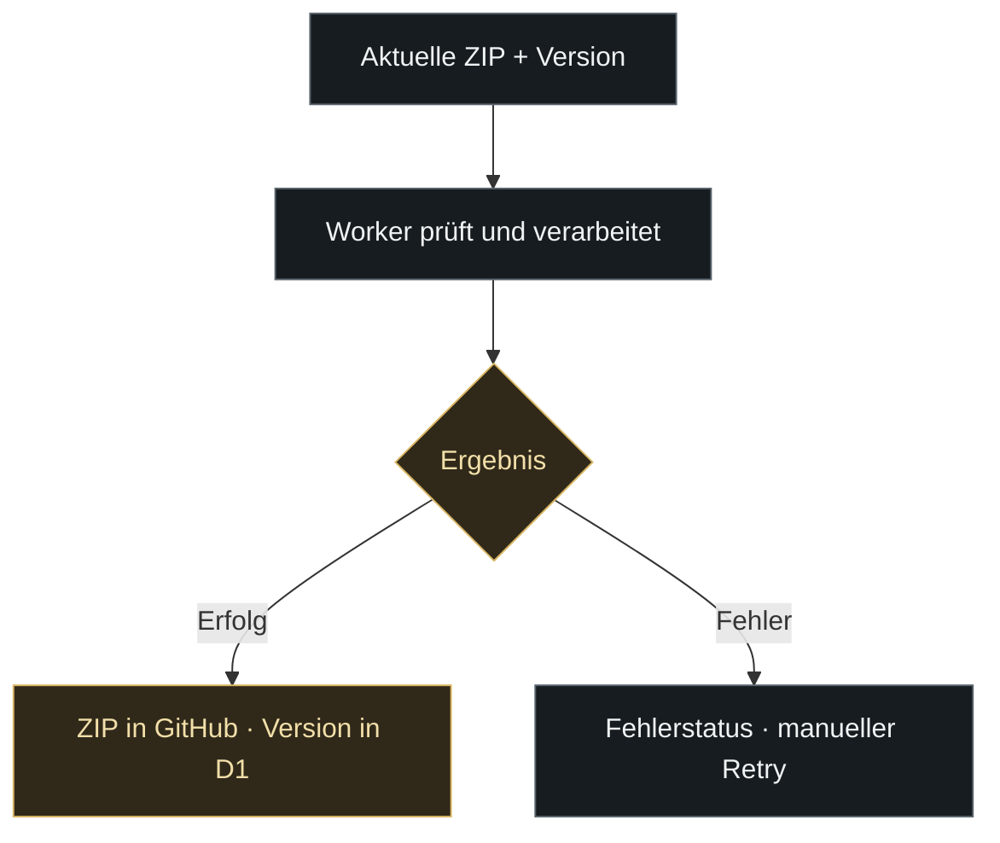
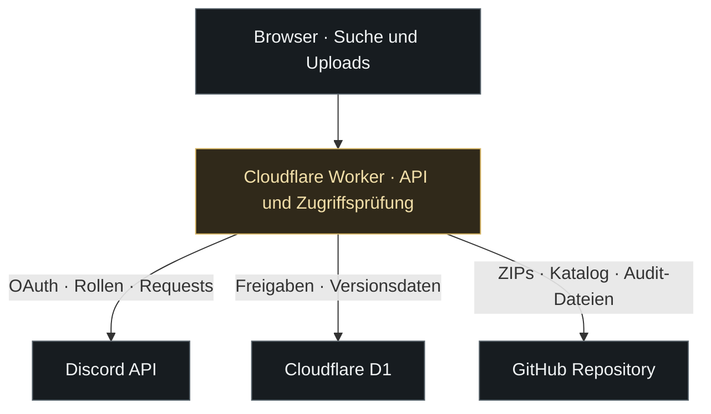

<p align="center">
  <a href="https://le-mans-ultimate-setups.lukastraudt-racing.workers.dev/">
    <picture>
      <source media="(max-width: 600px)" srcset=".github/readme/hero-mobile.svg">
      
    </picture>
  </a>
</p>

<p align="center">
  <a href="https://le-mans-ultimate-setups.lukastraudt-racing.workers.dev/"></a>
  <a href="CHANGELOG.md"></a>
</p>

<p align="center">
  <a href="#datenbank">Datenbank</a> &nbsp; / &nbsp;
  <a href="#uploads">Uploads</a> &nbsp; / &nbsp;
  <a href="#zugriff">Zugriff</a> &nbsp; / &nbsp;
  <a href="#discord">Discord & Audit</a> &nbsp; / &nbsp;
  <a href="#technik">Technik</a> &nbsp; / &nbsp;
  <a href="#betrieb">Betrieb</a>
</p>

<h1 align="center">LMU Setup Database</h1>

<p align="center">
  Die Teamplattform von <strong>Three Peaks Racing</strong> für <strong>Le Mans Ultimate</strong>.<br>
  Setup-ZIPs finden, hochladen und versionieren. Mit Discord-Zugang, individuellen Freigaben und einer nachvollziehbaren Änderungshistorie.
</p>

<p align="center">
  
</p>

<sub>Die Upload-Grenzen stammen aus der aktuellen Implementierung. Fahrzeugkatalog: <a href="setups.json">setups.json</a> · Upload-Prüfung: <a href="worker.js">worker.js</a> · Versionen: <a href="setup-version.js">setup-version.js</a>.</sub>

<a id="datenbank"></a>

## 

<table>
  <tr>
    <td width="50%" valign="top">
      <h3>Finden & auswählen</h3>
      <ul>
        <li>Fahrzeugklassenfilter und Fahrzeugsuche.</li>
        <li>Streckensuche innerhalb der Setup-Liste.</li>
        <li>Filter für GO, HYMO und beAlien.</li>
        <li>Setup-Zähler je Fahrzeug, passend zum Anbieterfilter.</li>
        <li>Gruppen für Standard/EVO sowie WEC/ELMS beim Oreca.</li>
      </ul>
    </td>
    <td width="50%" valign="top">
      <h3>Pflegen & organisieren</h3>
      <ul>
        <li>ZIP-Downloads direkt aus der Fahrzeugansicht.</li>
        <li>Mehrfachauswahl mit sequenziellem Upload.</li>
        <li>Gesamtfortschritt und Status pro Datei.</li>
        <li>Gezielter Retry für fehlgeschlagene Dateien.</li>
        <li>Versions-Editor und Löschen mit Bestätigungsdialog.</li>
      </ul>
    </td>
  </tr>
</table>

### Fahrzeugklassen

| Klasse | Beispiele aus dem Fahrzeugkatalog | Darstellung |
| :--- | :--- | :--- |
| **Hypercar** | Ferrari 499P, Porsche 963, BMW M Hybrid V8, Toyota GR010 | Eigene Fahrzeugansichten mit Anbieter- und Streckenfilter |
| **LMP2** | Oreca 07 Gibson | Zusätzliche Einteilung nach WEC, ELMS oder Other anhand des Dateinamens |
| **LMP3** | Adess AD25, Duqueine D09, Ginetta G61-LT-P325, Ligier JS P325 | Gemeinsame Suche und Setup-Verwaltung wie bei den anderen Klassen |
| **LMGT3** | BMW M4 LMGT3, Ferrari 296 LMGT3, Ford Mustang LMGT3, Porsche 911 GT3 R | Anbietergruppen und Standard-/EVO-Erkennung anhand des Dateinamens |

Der Fahrzeugkatalog steht in [`setups.json`](setups.json). Die tatsächlichen ZIPs werden für das ausgewählte Fahrzeug aus [`setups/`](setups) geladen. Ein Katalogeintrag bedeutet deshalb nicht automatisch, dass bereits Setups vorhanden sind.

### Setup-Anbieter

<table>
  <tr>
    <td align="center" width="33%"><br><strong>GO</strong></td>
    <td align="center" width="33%"><br><strong>HYMO</strong></td>
    <td align="center" width="33%"><br><strong>beAlien</strong></td>
  </tr>
</table>

Die Zuordnung zu Anbieter, Variante und Rennserie wird aus dem ZIP-Dateinamen abgeleitet. Die Streckensuche durchsucht ebenfalls den Dateinamen. Aussagekräftige Dateinamen helfen deshalb beim Filtern; Dateien ohne erkannten Anbieter bleiben unter „Alle“ sichtbar.

### Einstieg

1. **[Datenbank öffnen](https://le-mans-ultimate-setups.lukastraudt-racing.workers.dev/)** und mit Discord anmelden.
2. **Zugang erhalten:** über die Datenbankrolle oder eine individuelle Freigabe durch den Owner.
3. **Klasse und Fahrzeug wählen**, Anbieter und Strecke filtern und die ZIP herunterladen.

Die Oberfläche bietet einen gespeicherten Hell-/Dunkelmodus. Übersichtsseite und Fahrzeugansicht werden über die Browser-History verwaltet; auch die Zurück-Navigation per Maustaste oder Tastatur wird berücksichtigt.

<a id="uploads"></a>

### Uploads mit Überblick

| Schritt | Was passiert? |
| :--- | :--- |
| **01 · Version setzen** | Vor der Dateiauswahl eine Versionsangabe eingeben. Sie gilt für die Dateien des Upload-Vorgangs. |
| **02 · ZIPs auswählen** | Bis zu 50 Dateien auswählen. Jede ZIP darf höchstens 25 MiB groß und nicht leer sein. |
| **03 · Einzeln verarbeiten** | Die Oberfläche sendet jeweils eine Datei an den Worker. Er prüft unter anderem Berechtigung, Dateiendung, Größe und ZIP-Signatur. |
| **04 · Fortschritt verfolgen** | Verarbeitete Dateien, Gesamtzahl, Prozentwert, aktuelle Datei und Einzelstatus bleiben sichtbar. |
| **05 · Ergebnis übernehmen** | Erfolgreiche ZIPs liegen in GitHub; die zugehörige Version wird in D1 gespeichert. Die Fahrzeugliste wird nach dem Vorgang aktualisiert. |
| **06 · Fehler erneut versuchen** | Der Retry verarbeitet nur fehlgeschlagene Dateien. Bereits erfolgreiche Uploads werden dabei ausgelassen. |



**Der Prozentwert zählt verarbeitete Dateien.** Auch ein fehlgeschlagener Versuch wird mitgezählt. Bei 100 % ist der Vorgang abgeschlossen; die getrennten Erfolgs- und Fehlerzähler zeigen das Ergebnis. Ein Retry startet einen eigenen Fortschritt für die verbliebenen Dateien.

Bereits vorhandene Dateinamen werden beim Upload abgelehnt. Ein Upload überschreibt vorhandene ZIPs somit nicht automatisch.

### Versionen im Alltag

| Eigenschaft | Verhalten |
| :--- | :--- |
| **Format** | Freitext, zum Beispiel `1.0`, `v2`, `2.1.3` oder `2026.10` |
| **Länge** | Maximal 40 Zeichen; keine leeren Werte oder Steuerzeichen |
| **Speicherort** | D1-Tabelle `setup_versions`, zugeordnet über Klasse, Fahrzeug und Dateiname |
| **Bestehende Setups** | Ohne hinterlegte Version wird `—` angezeigt |
| **Nachträgliche Änderung** | Stift-Editor für Nutzer mit Upload-/Delete-Zugriff, auch bei älteren Setups |
| **ZIP-Datei** | Bleibt bei einer reinen Versionsänderung unverändert; kein erneuter Upload erforderlich |

<a id="zugriff"></a>

## 

### Wer darf was?

| Funktion | Nur angemeldet | Database Access | Upload / Delete | Owner |
| :--- | :---: | :---: | :---: | :---: |
| Setup Request senden | Ja | Ja | Ja | Ja |
| Fahrzeugkatalog & Setups ansehen | — | Ja | Ja | Ja |
| ZIPs herunterladen | — | Ja | Ja | Ja |
| ZIPs hochladen & löschen | — | — | Ja | Ja |
| Versionen bearbeiten | — | — | Ja | Ja |
| Individuelle Freigaben verwalten | — | — | — | Ja |
| Discord-Befehl `/request` registrieren | — | — | — | Ja |

**Database Access** erlaubt das Lesen und Herunterladen. **Upload / Delete** umfasst zusätzlich die schreibenden Setup-Funktionen und enthält den Datenbankzugriff. Der **Owner** verwaltet im Admin-Panel die individuellen Freigaben.

Die Anwendung prüft die Rechte auf dem Server. Die Sichtbarkeit eines Buttons ist zusätzlich an den angemeldeten Nutzer und dessen Freigaben gebunden.

<details>
<summary><strong>Wie Rollen und individuelle Freigaben zusammenwirken</strong></summary>

- Die reguläre Datenbankrolle wird über `DISCORD_DATABASE_ROLE_ID` konfiguriert; `DISCORD_ROLE_ID` dient als Fallback.
- Individuelle Datenbankfreigaben stehen in D1 unter `database_access`, individuelle Upload-Freigaben unter `upload_access`.
- Die aktuell äußere Access-Schicht gewährt Upload/Delete dem Owner, individuell freigegebenen Nutzern sowie Mitgliedern der optionalen Rolle `DISCORD_SETUP_REQUEST_ROLE_ID`.
- `DISCORD_UPLOAD_ROLE_ID` ist im Core vorhanden. Maßgeblich für die aktuellen Setup-Routen ist jedoch die davorliegende Prüfung in [`access-worker.js`](access-worker.js).
- Eine individuelle Upload-Freigabe trägt zugleich den Datenbankzugriff ein. Solange diese Upload-Freigabe besteht, kann die individuelle Datenbankfreigabe nicht separat entfernt werden.
- Rollenrechte und individuelle Freigaben werden gemeinsam berücksichtigt. Das Entfernen einer individuellen Freigabe entfernt keine Discord-Rolle.

</details>

<a id="discord"></a>

### Discord gehört zum Ablauf

<table>
  <tr>
    <td width="50%" valign="top">
      <h3>Login & Setup Requests</h3>
      <p>Discord OAuth übernimmt die Anmeldung. Ein Setup Request enthält Fahrzeug, Strecke, optional die Klasse und weitere Informationen.</p>
      <p>Der Worker sendet den Request in den konfigurierten Discord-Kanal. Der anfragende Nutzer kann erwähnt werden; eine zusätzliche Request-Rolle ist optional.</p>
      <p>Der registrierbare Befehl <code>/request</code> öffnet ein Formular direkt in Discord. Dafür muss der Interaction-Endpunkt eingerichtet sein.</p>
    </td>
    <td width="50%" valign="top">
      <h3>Presence & Audit-Meldungen</h3>
      <p>Der separate Presence Bot zeigt <strong>„Le Mans Ultimate“</strong> als Aktivität, einen Laufzeittimer und den Status <strong>DND</strong>.</p>
      <p>Audit-Meldungen im konfigurierten Kanal zeigen erfolgreiche Setup- und Freigabeänderungen als Discord-Embeds.</p>
      <p>Website-Integration und Presence Bot laufen unabhängig: der Worker auf Cloudflare, der Presence Bot als eigener Node.js-Prozess.</p>
    </td>
  </tr>
</table>

### Was die Audit-Logs festhalten

| Ereignis | Kennung im Log | Zusätzliche Angaben |
| :--- | :--- | :--- |
| Setup hochgeladen | `SETUP_UPLOAD` | Datei, Fahrzeug und Version |
| Setup gelöscht | `SETUP_DELETE` | Datei, Fahrzeug und zuvor gespeicherte Version, soweit vorhanden |
| Version geändert | `SETUP_VERSION_UPDATE` | Alter und neuer Versionswert |
| Freigabe erteilt | `PERMISSION_GRANT` | Betroffener Nutzer und Berechtigungsart |
| Freigabe entfernt | `PERMISSION_REVOKE` | Betroffener Nutzer und Berechtigungsart |

Jeder Eintrag enthält einen UTC-Zeitstempel, die Aktion und den ausführenden Discord-Nutzer. Weitere Felder werden ergänzt, soweit sie für das Ereignis vorhanden sind. Anbieter und Streckenangabe werden aus dem Dateinamen abgeleitet; die Streckenangabe ist dabei kein separat geprüfter Streckendatensatz.

Die JSON-Dateien liegen in [`audit-logs/`](audit-logs), nach Monat geordnet unter `audit-logs/JJJJ-MM/`. Jeder Dateiname enthält Zeitstempel und UUID. **Zuerst wird die Datei in GitHub gespeichert, danach die Discord-Meldung gesendet.** Ein Fehler beim Discord-Versand entfernt den GitHub-Eintrag nicht.

Der aktuelle Audit-Pfad dokumentiert erfolgreiche Änderungen. Fehlgeschlagene Upload-Versuche erscheinen im Upload-Status der Oberfläche.

<a id="technik"></a>

## 



### Welche Daten liegen wo?

| Bereich | Speicherort | Aufgabe |
| :--- | :--- | :--- |
| **Fahrzeugkatalog** | [`setups.json`](setups.json) in GitHub | Klassen und auswählbare Fahrzeuge |
| **Setup-ZIPs** | `setups/Klasse/Fahrzeug/Datei.zip` in GitHub | Downloadbare Dateien mit Git-Historie |
| **Individuelle Zugriffsrechte** | D1: `database_access`, `upload_access` | Freigaben mit zugehörigem Nutzer und Vergabeinformationen |
| **Setup-Versionen** | D1: `setup_versions` | Version je Klasse, Fahrzeug und ZIP-Datei |
| **Audit-Ereignisse** | JSON-Dateien in GitHub, zusätzlich Discord-Embeds | Nachvollziehbare Setup- und Freigabeänderungen |
| **Changelog** | [`CHANGELOG.md`](CHANGELOG.md), Cursor unter `.github/changelog/` | Deutsche Projekthistorie und bereits verarbeiteter Git-Stand |
| **Zugangsdaten** | Worker-Secrets bzw. Umgebung des Presence Bots | Discord-, GitHub- und Session-Zugangsdaten |

R2 (`UPLOADS_R2`) und eine Queue (`UPLOAD_QUEUE`) sind in [`wrangler.jsonc`](wrangler.jsonc) gebunden. Der aktuelle Upload schreibt direkt in GitHub. R2 und Queue sind daher in der Grafik nicht als aktive Upload-Stufen eingezeichnet.

### Die Worker-Schichten

Anfragen starten bei `runtime-worker.js` und werden bei Bedarf an die darunterliegende Schicht weitergegeben. Eine Schicht kann eine Route selbst beantworten; sie muss dann nicht den gesamten Stack durchlaufen.

| Reihenfolge | Datei | Zuständigkeit |
| :---: | :--- | :--- |
| **01** | [`runtime-worker.js`](runtime-worker.js) | Produktiver Entry Point, Schutz des Fahrzeugkatalogs und Audit für Freigabeänderungen |
| **02** | [`access-worker.js`](access-worker.js) | Zusätzliche Zugriffsprüfung, individuelle Freigaben, Versionsänderung und Setup-Audit |
| **03** | [`ui-hotfix.js`](ui-hotfix.js) | UI-Erweiterungen, Anbieterfilter, Zähler, Versions-Editor und Browser-Navigation |
| **04** | [`production-worker.js`](production-worker.js) | Website-Erweiterungen, Setup Requests, Discord-Interaktionen und Versionsspeicherung beim Upload |
| **05** | [`worker.js`](worker.js) | Core API, OAuth, Sessions, GitHub-Dateizugriff und Discord-Integration |

[`index.html`](index.html) enthält die grundlegende Oberfläche. [`setup-version.js`](setup-version.js) kapselt Versionsprüfung und D1-Zugriff; [`audit-log.js`](audit-log.js) schreibt Audit-Dateien und Discord-Meldungen.

<details>
<summary><strong>API-Überblick für die wichtigsten Abläufe</strong></summary>

| Methode | Route | Zweck | Voraussetzung |
| :--- | :--- | :--- | :--- |
| `GET` | `/api/me` | Login-Status und berechnete Nutzerrechte | Gibt auch den nicht angemeldeten Zustand zurück |
| `GET` | `/setups.json` | Fahrzeugkatalog laden | Database Access |
| `GET` | `/api/setups` | ZIPs eines Fahrzeugs mit Metadaten auflisten | Database Access |
| `GET` | `/api/setups/download` | Eine ZIP herunterladen | Database Access |
| `POST` | `/api/setups/upload` | Setup-ZIP und Version speichern | Upload / Delete |
| `POST` | `/api/setups/delete` | Setup-ZIP löschen | Upload / Delete |
| `POST` | `/api/setups/version` | Version einer vorhandenen ZIP ändern | Upload / Delete |
| `POST` | `/api/request` | Setup Request an Discord senden | Angemeldet |
| `GET` | `/api/admin/access` | Individuelle Freigaben gemeinsam auflisten | Owner |
| `GET`, `POST`, `DELETE` | `/api/admin/database-access` | Datenbankfreigaben lesen, erteilen und entfernen | Owner |
| `GET`, `POST`, `DELETE` | `/api/admin/upload-access` | Upload-Freigaben lesen, erteilen und entfernen | Owner |
| `POST` | `/interactions/discord` | Discord-Befehle und Formularantworten | Gültige Discord-Signatur |

Setup-Listen und Downloads verwenden `category` und `vehicle`; eine einzelne Datei wird zusätzlich über `name` ausgewählt. Uploads werden als `FormData` mit Klasse, Fahrzeug, Version und Datei gesendet.

</details>

### Vorhandene Schutzmechanismen

| Bereich | Umsetzung im Code |
| :--- | :--- |
| **Discord-Anmeldung** | OAuth-State-Abgleich; der State-Cookie gilt zehn Minuten |
| **Sessions** | HMAC-SHA-256-Signatur, Ablaufprüfung und Cookies mit `HttpOnly`, `Secure` und `SameSite=Lax`; maximale Session-Laufzeit sieben Tage |
| **Zugriffsrechte** | Serverseitige Prüfungen für Datenbank, Upload/Delete und Owner-Funktionen |
| **Dateien & Eingaben** | ZIP-Endung, Größenbegrenzung, Signaturprüfung, bereinigte Pfadbestandteile und Versionsprüfung |
| **D1-Zugriff** | Vorbereitete SQL-Abfragen mit gebundenen Parametern |
| **Discord-Interaktionen** | Ed25519-Prüfung von Signatur und Zeitstempel zusammen mit dem Request-Body |
| **Core-Worker** | HTTPS- und Origin-Prüfung sowie CSP und weitere Sicherheits-Header in den jeweiligen Antwortpfaden |
| **Konfiguration** | Vertrauliche Tokens und Schlüssel über Secrets bzw. Umgebungsvariablen |

Die Tabelle beschreibt vorhandene Bausteine im Code. Die tatsächliche Verarbeitung einer Route ergibt sich aus den oben aufgeführten Worker-Schichten.

<a id="betrieb"></a>

## 

### Cloudflare & Konfiguration

| Bestandteil | Konfiguration |
| :--- | :--- |
| **Produktiver Worker** | `runtime-worker.js`, festgelegt als `main` in [`wrangler.jsonc`](wrangler.jsonc) |
| **Website-Dateien** | Asset-Binding `ASSETS`; der Worker wird zuerst ausgeführt |
| **D1-Datenbank** | Binding `ACCESS_DB` für Freigaben und Versionen |
| **Repository-Ziel** | `GITHUB_OWNER`, `GITHUB_REPO`, `GITHUB_BRANCH` |
| **Website-Adresse** | `SITE_URL`; OAuth-Callback unter `/auth/discord/callback` |
| **Bereitstellung** | Bestehende Cloudflare-Build-Anbindung an den Branch `main` |

<details>
<summary><strong>Discord-Einstellungen, Secrets und D1-Voraussetzungen</strong></summary>

| Variable | Aufgabe |
| :--- | :--- |
| `DISCORD_CLIENT_ID`, `DISCORD_CLIENT_SECRET` | Discord OAuth für die Website |
| `DISCORD_GUILD_ID`, `DISCORD_BOT_TOKEN` | Server-, Rollen- und Bot-API-Zugriff |
| `DISCORD_DATABASE_ROLE_ID`, `DISCORD_ROLE_ID` | Datenbankrolle und Fallback |
| `DISCORD_SETUP_REQUEST_ROLE_ID` | Optionale Rolle für Request-Erwähnungen; wird in der aktuellen Access-Schicht auch für Upload/Delete ausgewertet |
| `DISCORD_CHANNEL_ID` | Zielkanal für Setup Requests |
| `DISCORD_AUDIT_CHANNEL_ID` | Zielkanal für Audit-Embeds |
| `GITHUB_TOKEN` | Zugriff auf Setup-Dateien und Schreiben von Audit-Dateien |
| `SESSION_SECRET` | Signieren und Prüfen der Website-Sessions |

`DISCORD_CLIENT_SECRET`, `DISCORD_BOT_TOKEN`, `GITHUB_TOKEN` und `SESSION_SECRET` werden als Worker-Secrets hinterlegt. Der Presence Bot erhält seinen Bot-Token separat über seine Laufzeitumgebung.

Für die aktuellen Rechte- und Versionsfunktionen müssen in D1 `database_access`, `upload_access` und `setup_versions` vorhanden sein. [`schema.sql`](schema.sql) enthält derzeit `upload_access` sowie zusätzliche Cache- und Upload-Tabellen; es ist kein vollständiges Installationsschema für alle heutigen Funktionen. Bei einer neuen D1-Datenbank müssen die fehlenden Rechte- und Versionstabellen zusätzlich eingerichtet werden.

</details>

### Presence Bot starten

Der Presence Bot benötigt **Node.js 20 oder neuer**, die Paketabhängigkeiten und `DISCORD_BOT_TOKEN` in der Umgebung oder einer lokalen `.env`-Datei. Die Vorlage steht in [`discord-presence/.env.example`](discord-presence/.env.example).

```bash
cd discord-presence
npm install
npm start
```

`npm start` führt [`discord-presence/index.js`](discord-presence/index.js) aus. Der Prozess muss separat laufen, damit die Presence dauerhaft angezeigt wird. Weitere Hosting-Hinweise stehen in [`discord-presence/README.txt`](discord-presence/README.txt).

### Der Changelog aktualisiert sich selbst

| Auslöser | Verhalten |
| :--- | :--- |
| **Technische Änderung auf `main`** | Startet die Aktualisierung und berücksichtigt neue, noch nicht verarbeitete Commits |
| **ZIP-Uploads & Audit-Dateien** | Werden gesammelt beim nächsten technischen Lauf oder beim geplanten täglichen Lauf erfasst |
| **Täglicher Zeitplan** | GitHub Actions ist für `03:23 UTC` eingeplant |
| **Manueller Start** | Actions → „Changelog automatisch ergänzen“ → „Run workflow“ |
| **Ergebnis** | Bot-Commit mit Einträgen in `CHANGELOG.md` und aktualisiertem Verarbeitungscursor |

Die deutschen Texte stammen entweder aus einem `Changelog:`-Abschnitt in der Commit-Nachricht oder aus festen Beschreibungen der tatsächlichen Dateiänderungen. Für einen konkreten Funktionstext kann die Commit-Nachricht zum Beispiel so ergänzt werden:

```text
Changelog:
- [Ergänzt] Gesamtfortschritt während eines Upload-Vorgangs angezeigt.
- [Dokumentation] Upload-Grenzen und Zugriffsrechte im README erklärt.
```

Die Automation verhindert doppelte Verarbeitung über einen Cursor. Bestehende manuelle Einträge bleiben erhalten. Der Schreibjob ist auf `CHANGELOG.md` und den Cursor begrenzt; Bot-Commits starten keine endlose Aktualisierungskette.

**Kosten:** Im öffentlichen Repository laufen die Changelog-Jobs auf kostenlosen GitHub-Standard-Runnern. Sie brauchen weder eine KI-API noch einen zusätzlichen API-Schlüssel. Bei einem privaten Repository werden diese Jobs übersprungen. Diese Kostenangabe bezieht sich auf die Changelog-Automation.

<details>
<summary><strong>Automation lokal prüfen</strong></summary>

```bash
python3 -m unittest discover -s .github/changelog -p 'test_*.py' -v
python3 .github/changelog/update_changelog.py --dry-run
```

Der Probelauf verändert keine Dateien. Ausführliche Regeln, Kategorien und Beispiele stehen in der [Dokumentation der Changelog-Automation](.github/changelog/README.md).

</details>

[Projekthistorie lesen](CHANGELOG.md) &nbsp; / &nbsp; [Changelog-Workflow ansehen](https://github.com/lukasracinglmu/Le-Mans-Ultimate-Setups/actions/workflows/changelog.yml) &nbsp; / &nbsp; [Konfiguration öffnen](wrangler.jsonc)

<p align="center">
  
</p>
