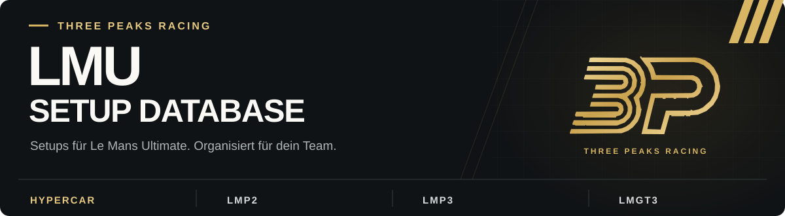

  <a href="https://le-mans-ultimate-setups.3peaks-database.workers.dev/">
    <picture>
      <source media="(max-width: 600px)" srcset=".github/readme/hero-mobile.svg">
      
    </picture>
  </a>

<h1 align="center">Three Peaks Racing · LMU Setup Database</h1>

  <strong>Finde schneller das passende Setup für Le Mans Ultimate.</strong> 
  Fahrzeuge auswählen, Setups vergleichen, herunterladen und direkt losfahren.

  

---

## Willkommen

Die Three Peaks Racing Setup Database ist dein zentraler Ort für Setups zu **Le Mans Ultimate**.

Die Fahrzeuge sind übersichtlich nach Rennklasse sortiert. Über die Suche und die Filter findest du ohne Umwege das Auto, das du gerade für dein Rennen brauchst.

Unterstützt werden:

| Rennklasse | Beschreibung |
| :--- | :--- |
| **Hypercar** | Die schnellsten Prototypen |
| **LMP2** | Leistungsstarke Langstrecken-Prototypen |
| **LMP3** | Kompakte Prototypen mit engem Racing |
| **LMGT3** | GT-Fahrzeuge für packende Zweikämpfe |
| **GTE** | GT-Rennwagen der GTE-Klasse |

## Schnellstart

1. Öffne die [Setup Database](https://le-mans-ultimate-setups.3peaks-database.workers.dev/).
2. Melde dich mit Discord an.
3. Suche nach deinem Fahrzeug oder wähle eine Rennklasse.
4. Öffne das Fahrzeug.
5. Wähle das passende Setup und starte den Download.

Die Fahrzeugübersicht zeigt dir außerdem direkt, wie viele Setups für ein Fahrzeug verfügbar sind.

## Fahrzeuge finden

Die Übersicht bietet mehrere schnelle Wege zum passenden Fahrzeug:

- **Suche:** Fahrzeugnamen direkt eingeben.
- **Rennklassenfilter:** Hypercar, LMP2, LMP3, LMGT3 oder GTE auswählen.
- **Setup-Hersteller:** Nach GO, HYMO oder beAlien filtern.
- **Favoriten:** Fahrzeuge mit dem goldenen Stern markieren und später über „Favoriten anzeigen“ wiederfinden.

Favoriten sind persönlich gespeichert. Andere Nutzer sehen deine Auswahl nicht.

## Setups nutzen

Auf der Fahrzeugseite findest du die verfügbaren Setups übersichtlich gruppiert. Je nach Setup werden zusätzliche Informationen wie Hersteller, Rennserie, Variante und Version angezeigt.

Ein Setup kann als **veraltet** gekennzeichnet sein. Das bedeutet nicht automatisch, dass es unbrauchbar ist – es weist lediglich darauf hin, dass eine aktuellere Alternative existieren kann.

## Setup Request

Fehlt dir ein Setup für eine bestimmte Strecke oder Rennserie?

Dann kannst du direkt über **Setup Request** eine Anfrage senden. Wähle das Fahrzeug aus, ergänze Strecke und Rennserie und füge bei Bedarf weitere Informationen hinzu.

Je genauer deine Angaben sind, desto leichter kann die Anfrage bearbeitet werden.

## Bug melden

Wenn dir ein Fehler auffällt, kannst du über **Bug melden** direkt eine Meldung erstellen.

Hilfreich sind:

- eine kurze, verständliche Beschreibung,
- das betroffene Fahrzeug oder Setup,
- die Schritte, mit denen der Fehler auftritt,
- optional ein Screenshot.

So kann das Problem schneller nachvollzogen und behoben werden.

## Tipps für bessere Ergebnisse

- Suche zuerst nach dem vollständigen Fahrzeugnamen.
- Nutze die Rennklasse, wenn du viele Ergebnisse siehst.
- Prüfe Hersteller, Rennserie und Variante vor dem Download.
- Markiere häufig genutzte Fahrzeuge mit dem Stern.
- Beschreibe Setup Requests möglichst konkret.
- Hänge bei sichtbaren Fehlern einen Screenshot an.

## Häufige Fragen

### Muss ich mich anmelden?

Ja. Die Anmeldung erfolgt sicher über Discord und ermöglicht die Nutzung der Setup Database.

### Kann ich meine Favoriten auf anderen Geräten sehen?

Ja, solange du dich mit demselben Discord-Account anmeldest.

### Was bedeutet „veraltet“?

Ein veraltetes Setup bleibt sichtbar, ist aber möglicherweise nicht mehr die aktuellste Variante für dieses Fahrzeug.

### Warum sehe ich ein bestimmtes Fahrzeug nicht?

Prüfe zunächst die Suche und die aktiven Filter. Wenn du angemeldet bist, sollte die Fahrzeugübersicht nach dem Laden automatisch erscheinen.

### Wie melde ich einen Fehler?

Öffne **Bug melden**, beschreibe das Problem möglichst genau und füge bei Bedarf einen Screenshot hinzu.

## Three Peaks Racing

Die Datenbank wird von **Three Peaks Racing** für die LMU-Community betrieben.

  <a href="https://le-mans-ultimate-setups.3peaks-database.workers.dev/"><strong>Zur Setup Database</strong></a>

  

