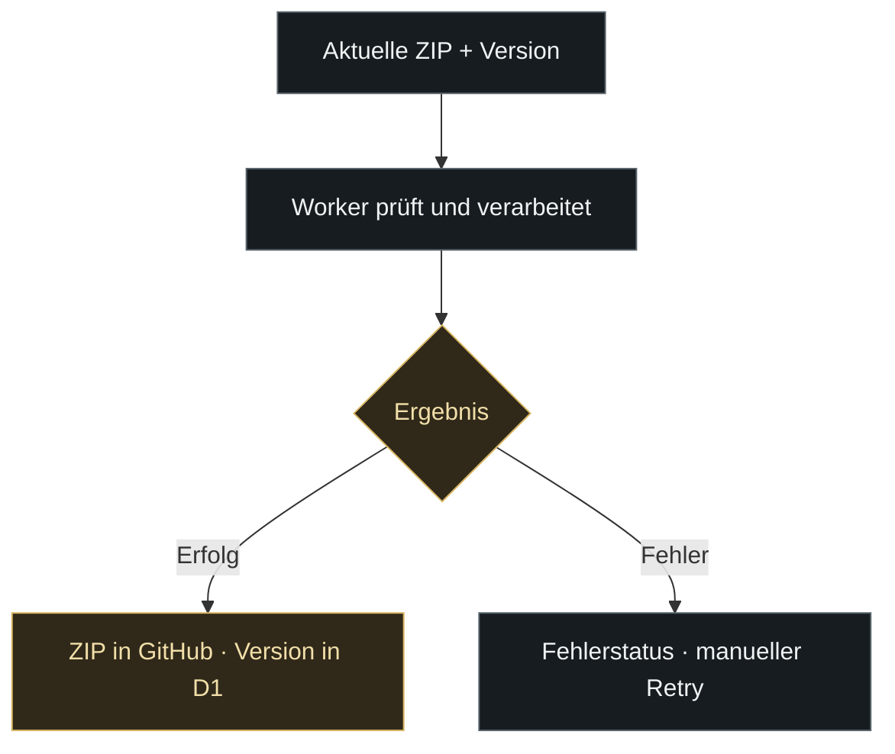
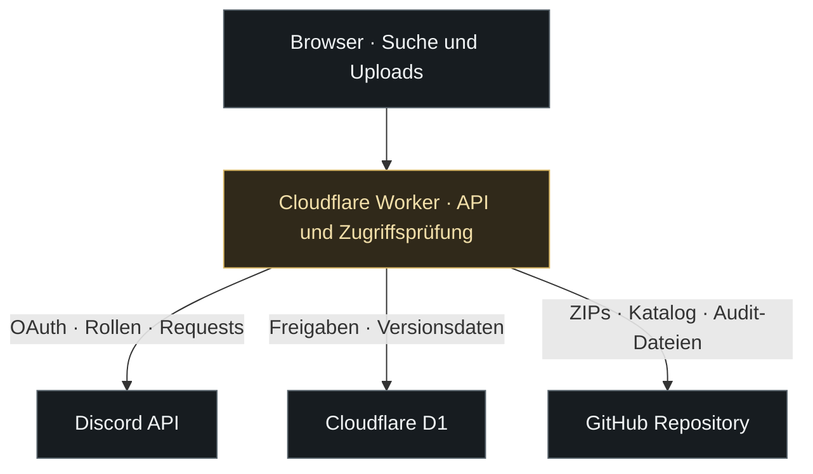

<p align="center">
  <a href="https://le-mans-ultimate-setups.lukastraudt-racing.workers.dev/">
    <picture>
      <source media="(max-width: 600px)" srcset=".github/readme/hero-mobile.svg">
      
    </picture>
  </a>
</p>

<p align="center">
  <a href="https://le-mans-ultimate-setups.lukastraudt-racing.workers.dev/"></a>
  <a href="CHANGELOG.md"></a>
</p>

<p align="center">
  <a href="#datenbank">Datenbank</a> &nbsp; / &nbsp;
  <a href="#uploads">Uploads</a> &nbsp; / &nbsp;
  <a href="#zugriff">Zugriff</a> &nbsp; / &nbsp;
  <a href="#discord">Discord & Audit</a> &nbsp; / &nbsp;
  <a href="#technik">Technik</a> &nbsp; / &nbsp;
  <a href="#betrieb">Betrieb</a> &nbsp; / &nbsp;
  <a href="#einrichtung">Einrichtung</a> &nbsp; / &nbsp;
  <a href="#fehler">Fehlersuche</a>
</p>

<h1 align="center">LMU Setup Database</h1>

<p align="center">
  Die Teamplattform von <strong>Three Peaks Racing</strong> für <strong>Le Mans Ultimate</strong>.<br>
  Setup-ZIPs finden, hochladen und versionieren. Mit Discord-Zugang, individuellen Freigaben und einer nachvollziehbaren Änderungshistorie.
</p>

<p align="center">
  
</p>

<sub>Die Upload-Grenzen stammen aus der aktuellen Implementierung. Fahrzeugkatalog: <a href="setups.json">setups.json</a> · Upload-Prüfung: <a href="worker.js">worker.js</a> · Versionen: <a href="setup-version.js">setup-version.js</a>.</sub>

| Du möchtest … | Hier geht es weiter |
| :--- | :--- |
| Ein Setup finden, hochladen oder bearbeiten | [Datenbank](#datenbank), [Dateinamen](#dateinamen), [Uploads](#uploads), [Versionen](#versionen) |
| Nutzer freigeben und Discord einrichten | [Berechtigungen](#zugriff), [Admin-Panel](#admin), [Discord](#discord) |
| Eine Instanz betreiben oder einen Fehler eingrenzen | [Architektur](#technik), [Einrichtung](#einrichtung), [Diagnose](#fehler), [Wartung](#wartung) |

<a id="datenbank"></a>

## 

<table>
  <tr>
    <td width="50%" valign="top">
      <h3>Finden & auswählen</h3>
      <ul>
        <li>Fahrzeugklassenfilter und Fahrzeugsuche.</li>
        <li>Streckensuche innerhalb der Setup-Liste.</li>
        <li>Filter für GO, HYMO und beAlien.</li>
        <li>Setup-Zähler je Fahrzeug, passend zum Anbieterfilter.</li>
        <li>Gruppen für Standard/EVO sowie WEC/ELMS beim Oreca.</li>
      </ul>
    </td>
    <td width="50%" valign="top">
      <h3>Pflegen & organisieren</h3>
      <ul>
        <li>ZIP-Downloads direkt aus der Fahrzeugansicht.</li>
        <li>Mehrfachauswahl mit sequenziellem Upload.</li>
        <li>Gesamtfortschritt und Status pro Datei.</li>
        <li>Gezielter Retry für fehlgeschlagene Dateien.</li>
        <li>Versions-Editor und Löschen mit Bestätigungsdialog.</li>
      </ul>
    </td>
  </tr>
</table>

### Fahrzeugklassen

| Klasse | Beispiele aus dem Fahrzeugkatalog | Darstellung |
| :--- | :--- | :--- |
| **Hypercar** | Ferrari 499P, Porsche 963, BMW M Hybrid V8, Toyota GR010 | Eigene Fahrzeugansichten mit Anbieter- und Streckenfilter |
| **LMP2** | Oreca 07 Gibson | Zusätzliche Einteilung nach WEC, ELMS oder Other anhand des Dateinamens |
| **LMP3** | Adess AD25, Duqueine D09, Ginetta G61-LT-P325, Ligier JS P325 | Gemeinsame Suche und Setup-Verwaltung wie bei den anderen Klassen |
| **LMGT3** | BMW M4 LMGT3, Ferrari 296 LMGT3, Ford Mustang LMGT3, Porsche 911 GT3 R | Anbietergruppen und Standard-/EVO-Erkennung anhand des Dateinamens |

Der Fahrzeugkatalog steht in [`setups.json`](setups.json). Die tatsächlichen ZIPs werden für das ausgewählte Fahrzeug aus [`setups/`](setups) geladen. Ein Katalogeintrag bedeutet deshalb nicht automatisch, dass bereits Setups vorhanden sind.

<details>
<summary><strong>Vollständiger Fahrzeugkatalog des dokumentierten Stands</strong></summary>

| Klasse | Fahrzeuge |
| :--- | :--- |
| **Hypercar** | Alpine A424 · Aston Martin Valkyrie AMR LMH · BMW M Hybrid V8 · Cadillac V-Series.R · Ferrari 499P · Genesis GMR-001 · Glickenhaus SCG 007 · Isotta Fraschini Tipo6-C · Lamborghini SC63 · Peugeot 9X8 · Porsche 963 · Toyota GR010 · Vanwall Vandervell 680 |
| **LMP2** | Oreca 07 Gibson |
| **LMP3** | Adess AD25 · Duqueine D09 · Ginetta G61-LT-P325 · Ligier JS P325 |
| **LMGT3** | Aston Martin Vantage AMR LMGT3 · BMW M4 LMGT3 · Chevrolet Corvette Z06 LMGT3.R · Ferrari 296 LMGT3 · Ford Mustang LMGT3 · Lamborghini Huracán LMGT3 · Lexus RC F LMGT3 · McLaren 720S LMGT3 · Mercedes-AMG LMGT3 · Porsche 911 GT3 R |

Maßgeblich für spätere Ergänzungen bleibt `setups.json`. Die Website lädt den Katalog zur Laufzeit aus dem konfigurierten Repository und Branch.

</details>

### Setup-Anbieter

<table>
  <tr>
    <td align="center" width="33%"><br><strong>GO</strong></td>
    <td align="center" width="33%"><br><strong>HYMO</strong></td>
    <td align="center" width="33%"><br><strong>beAlien</strong></td>
  </tr>
</table>

Die Zuordnung zu Anbieter, Variante und Rennserie wird aus dem ZIP-Dateinamen abgeleitet. Die Streckensuche durchsucht ebenfalls den Dateinamen. Aussagekräftige Dateinamen helfen deshalb beim Filtern; Dateien ohne erkannten Anbieter bleiben unter „Alle“ sichtbar.

<a id="dateinamen"></a>

#### So greifen Dateinamen und Filter ineinander

| Merkmal | Erkennung | Beispiel für einen Dateinamen |
| :--- | :--- | :--- |
| **HYMO** | Enthält `HYMO`, unabhängig von Groß-/Kleinschreibung | `HYMO_LeMans_Race.zip` |
| **beAlien** | Enthält `BEALIEN` oder `BE_ALIEN` | `beAlien_Spa_Qualifying.zip` |
| **GO** | Enthält ein erkennbares `GO`, beispielsweise `_GO` oder das eigenständige Wort | `Imola_GO_Race.zip` |
| **EVO** | `EVO` steht als abgegrenztes Merkmal im Namen | `LeMans_GO_EVO.zip` |
| **WEC / ELMS** | Beim Oreca 07 wird das entsprechende abgegrenzte Kürzel gesucht; sonst `Other` | `HYMO_Spa_WEC.zip` |
| **Strecke** | Die eingegebene Suche wird mit dem vollständigen Dateinamen verglichen | Die Suche nach `Spa` findet Dateinamen mit `Spa` |

Die Beispiele sind Benennungsvorschläge, keine vorhandenen Downloads. Bei GO ist ein Bestandteil wie `_GO` zuverlässig erkennbar; nur `GO_` am Anfang erfüllt die aktuelle Wortgrenzenprüfung nicht automatisch. Klasse und Fahrzeug ergeben sich aus der gewählten Fahrzeugansicht und dem Speicherpfad. Sie werden nicht aus dem ZIP-Namen erraten. Enthält ein Name mehrere Anbieterkennungen, hat HYMO vor beAlien und GO Vorrang; beim Oreca wird ELMS vor WEC ausgewertet.

Der Anbieterfilter auf der Startseite und in der Fahrzeugansicht verwendet denselben ausgewählten Anbieter. Der Fahrzeugzähler zählt die dazu passenden ZIPs. Ein Filter auf HYMO blendet beispielsweise GO-Dateien aus, auch wenn die Strecke passt. Die Streckensuche vergleicht Zeichenfolgen; unterschiedliche Schreibweisen wie `Le Mans` und `LeMans` werden nicht automatisch vereinheitlicht.

### Einstieg

1. **[Datenbank öffnen](https://le-mans-ultimate-setups.lukastraudt-racing.workers.dev/)** und mit Discord anmelden.
2. **Zugang erhalten:** über die Datenbankrolle oder eine individuelle Freigabe durch den Owner.
3. **Klasse und Fahrzeug wählen**, Anbieter und Strecke filtern und die ZIP herunterladen.

Die Oberfläche bietet einen gespeicherten Hell-/Dunkelmodus. Übersichtsseite und Fahrzeugansicht werden über die Browser-History verwaltet; auch die Zurück-Navigation per Maustaste oder Tastatur wird berücksichtigt.

<a id="uploads"></a>

### Uploads mit Überblick

| Schritt | Was passiert? |
| :--- | :--- |
| **01 · Version setzen** | Optional eine gemeinsame Versionsangabe eingeben. Sie wird bei Einzel-Uploads und bei der Auswahl „Ja“ verwendet. |
| **02 · ZIPs auswählen** | Bis zu 50 Dateien auswählen. Jede ZIP darf höchstens 25 MiB groß und nicht leer sein. |
| **03 · Versionen zuordnen** | Bei mehreren ZIPs erscheint „Haben alle Setups die gleiche Version?“. **Ja** startet den Upload mit der gemeinsamen Version. **Nein** öffnet eine Liste mit Dateinamen und je einem optionalen Versionsfeld; anschließend „Hochladen“ wählen. |
| **04 · Einzeln verarbeiten** | Die Oberfläche sendet jeweils eine Datei an den Worker. Er prüft unter anderem Berechtigung, Dateiendung, Größe und ZIP-Signatur. |
| **05 · Fortschritt verfolgen** | Verarbeitete Dateien, Gesamtzahl, Prozentwert, aktuelle Datei und Einzelstatus bleiben sichtbar. |
| **06 · Ergebnis übernehmen** | Erfolgreiche ZIPs liegen in GitHub; die zugehörige Version wird in D1 gespeichert. Die Fahrzeugliste wird nach dem Vorgang aktualisiert. |
| **07 · Fehler abfangen** | Vorübergehende Fehler werden je Datei bis zu fünfmal versucht. Danach verarbeitet der manuelle Retry nur verbliebene Fehler; bestätigte Erfolge werden ausgelassen. |



**Der Prozentwert zählt verarbeitete Dateien.** Auch ein fehlgeschlagener Versuch wird mitgezählt. Bei 100 % ist der Vorgang abgeschlossen; die getrennten Erfolgs- und Fehlerzähler zeigen das Ergebnis. Ein Retry startet einen eigenen Fortschritt für die verbliebenen Dateien.

Bei gleichem Dateinamen vergleicht der Worker die Git-Blob-Prüfsumme mit dem ZIP-Inhalt. Eine identische Datei wird als bereits gespeichert bestätigt und ihre angegebene Version gespeichert. Eine andere Datei unter demselben Namen wird abgelehnt und niemals automatisch überschrieben. Das verhindert falsche Fehler nach einer verlorenen Erfolgsantwort.

#### Status, Wiederholung und Unterbrechungen

| Status | Bedeutung | Nächster Schritt |
| :--- | :--- | :--- |
| **Wartet** | Datei ist ausgewählt und noch nicht verarbeitet | Die nächste freie Position in der sequenziellen Verarbeitung abwarten |
| **Wird hochgeladen** | Für diese Datei läuft der angezeigte Versuch von maximal fünf | Ergebnis des Requests abwarten |
| **Erneuter Versuch in … s** | Netzwerk, vorübergehender GitHub-Fehler oder ein API-Limit erfordert eine Pause | Tab geöffnet lassen; die Datei wird automatisch erneut versucht |
| **Erfolgreich** | Der Worker hat die Datei im Feld `uploaded` bestätigt | Datei ist nicht Teil des nächsten Fehler-Retrys |
| **Fehlgeschlagen** | Lokale Prüfung, Netzwerk oder Serverantwort haben keinen bestätigten Erfolg ergeben | Ursache prüfen und gezielt erneut versuchen |

Während eines Vorgangs sind Upload- und Retry-Schaltfläche gesperrt. Der Prozentwert wird nach abgeschlossenen Dateiversuchen erhöht; es gibt keine Messung der übertragenen Bytes innerhalb einer einzelnen ZIP. Während einer großen Datei kann der Gesamtwert deshalb kurz unverändert bleiben.

Die ausgewählten Dateien und Fehlerjobs liegen im Arbeitsspeicher des Browser-Tabs. Die Anwendung hat im aktuellen Upload-Pfad keine dauerhaft gespeicherte Wiederaufnahme nach Neuladen oder Schließen des Tabs. Für einen zuverlässigen Abschluss die Fahrzeugansicht und den Tab während des Vorgangs geöffnet lassen. Ein neuer Vorgang fragt bei mehreren ZIPs erneut nach der Versionszuordnung. Ein Retry behält die ursprünglich jeder Datei zugeordnete Version, auch wenn das gemeinsame Feld inzwischen geändert wurde. „Abbrechen“ oder Escape schließt die Abfrage ohne Upload; bis zur Bestätigung wird keine ZIP gesendet.

Zwischen Dateien liegt eine kurze Pause. Das Upload-Audit wird vor der Antwort abgeschlossen; auch hier gibt es Abstand zum vorherigen Schreibzugriff. Andere Nutzer und externe Änderungen können weiterhin Konflikte verursachen, die erneut geprüft werden.

Cloudflare startet auf `main` bei reinen Änderungen an `setups/**`, `audit-logs/**`, `CHANGELOG.md`, `.github/changelog/state.json` oder `README.md` keinen Worker-Neubuild mehr. Die Setup-Dateien und Listen werden weiterhin direkt aus GitHub gelesen. Dadurch lösen ZIP-Uploads keine unnötigen Deployments aus. Änderungen am Worker-Code und an Website-Assets bleiben vom normalen Build-Pfad erfasst.

Die 50-Dateien-Grenze gilt für eine Auswahl. Die Oberfläche bündelt nicht alle ZIPs in einen einzigen großen Request, sondern sendet eine Datei nach der anderen. Pro Datei sind bis zu fünf automatische Versuche vorgesehen. Bei vorübergehenden Fehlern steigen die Pausen ab zwei Sekunden an; ein kleiner Zufallsanteil verteilt gleichzeitige Wiederholungen. `Retry-After` und GitHub-Limit-Resets haben Vorrang. Eine lange Limit-Pause kann den Vorgang entsprechend verlängern. Nach fünf Versuchen bleibt die Datei als Fehler mit genauer Ursache und manuellem Retry sichtbar. Ungültige Dateien, fehlende Berechtigung und unterschiedliche Inhalte unter demselben Namen werden nicht automatisch wiederholt. Die ausgewählte Version bleibt bei jedem Versuch erhalten.

#### Wenn ein Teil schon gespeichert wurde

GitHub-Datei, D1-Version und Audit-Ereignis werden in getrennten Schritten geschrieben. Sie bilden keine gemeinsame Transaktion über alle Dienste.

| Fall | Möglicher Stand | Sinnvolle Kontrolle |
| :--- | :--- | :--- |
| GitHub akzeptiert die ZIP, danach scheitert D1 | Worker meldet einen vorübergehenden Fehler statt eines vollständigen Erfolgs | Automatischer Retry erkennt die identische ZIP und versucht die Versionsspeicherung erneut |
| Antwort kommt wegen eines Netzwerkfehlers nicht an | Der Speicherstand ist zunächst unklar | Erneuter Versuch prüft den Dateiinhalt und bestätigt eine bereits gespeicherte identische ZIP |
| Speichern klappt, Audit-Schreiben scheitert | Setup-Änderung kann erfolgreich sein, ohne dass ein Audit-Eintrag erscheint | Worker-Logs und Audit-Konfiguration prüfen |
| Nachladen der Liste scheitert | Die Upload-Erfolge bleiben gezählt; die Anzeige kann veraltet sein | Liste erneut öffnen bzw. Seite nach Abschluss neu laden |

Ein gleicher Name mit unterschiedlichem Inhalt bleibt ein echter Konflikt. Die ZIP in diesem Fall prüfen und bei Bedarf umbenennen. Eine 100-prozentige Erfolgsquote ist bei dauerhaften Dienstausfällen, fehlenden Rechten oder ungültigen Dateien nicht garantiert; solche Fehler bleiben sichtbar.

<a id="versionen"></a>

### Versionen im Alltag

| Eigenschaft | Verhalten |
| :--- | :--- |
| **Format** | Freitext, zum Beispiel `1.0`, `v2`, `2.1.3` oder `2026.10` |
| **Länge** | Maximal 40 Zeichen; keine Steuerzeichen. Beim Upload optional, im nachträglichen Stift-Editor ist eine Angabe erforderlich |
| **Speicherort** | D1-Tabelle `setup_versions`, zugeordnet über Klasse, Fahrzeug und Dateiname |
| **Bestehende Setups** | Ohne hinterlegte Version wird `—` angezeigt; auch neue ZIPs dürfen ohne Version hochgeladen werden |
| **Nachträgliche Änderung** | Stift-Editor für Nutzer mit Upload-/Delete-Zugriff, auch bei älteren Setups |
| **ZIP-Datei** | Bleibt bei einer reinen Versionsänderung unverändert; kein erneuter Upload erforderlich |

**Version bearbeiten:** Fahrzeug öffnen, neben der gewünschten ZIP auf den Stift klicken, Versionswert eingeben und speichern. Bei Erfolg wird die sichtbare Liste angepasst. Bei einem Fehler bleibt das Formular mit der Fehlermeldung offen. „Abbrechen“ bzw. ein Klick auf den Hintergrund schließt es ohne Speichern.

Die Angabe ist eine manuell gepflegte Kennzeichnung. Das System vergleicht keine Versionsnummern, sortiert nicht nach einer SemVer-Regel und prüft nicht, ob die ZIP zu einer bestimmten LMU-Spielversion passt. Versionen wie `v2` und `2.0` werden als unterschiedliche Texte behandelt.

Die Upload-Tests laufen bei Änderungen am Worker-Code und an den Tests über den Workflow „Upload-Logik prüfen“ auf einem kostenlosen Standard-Runner im öffentlichen Repository. Die Upload-Versionsprüfung und Speicherung lassen sich ohne zusätzliche Pakete mit `node --test tests/*.test.mjs` prüfen (Node.js 22 oder neuer).

#### Löschen und Wiederherstellen

Eine einzelne ZIP wird über das Papierkorb-Symbol und den anschließenden Bestätigungsdialog gelöscht. Die Oberfläche lädt danach die Fahrzeugliste erneut. Eine automatische Auswahl „veralteter“ ZIPs anhand der Version ist im aktuellen Code nicht enthalten.

Die Website bietet keinen Papierkorb und keinen Wiederherstellen-Button. Für eine Wiederherstellung wird die gewünschte Datei aus der Git-Historie wieder an ihrem ursprünglichen Pfad bereitgestellt. Die zugehörigen Versionsdaten liegen separat in D1 und müssen ebenfalls geprüft werden. Der aktuelle Löschpfad enthält keine ausdrückliche Bereinigung der zugehörigen `setup_versions`-Zeile.

<a id="zugriff"></a>

## 

### Wer darf was?

Die Rollen werden auf dem Discord-Server `1464926567401652418` geprüft. Die persönliche Owner-ID behält den vollständigen Zugriff.

| Funktion | Nur angemeldet | Team | Setup Supply | Owner-Rolle | Du (Owner-ID) |
| :--- | :---: | :---: | :---: | :---: | :---: |
| Setup Request senden | Ja | Ja | Ja | Ja | Ja |
| Katalog, Setups und Downloads | — | Ja | Ja | Ja | Ja |
| Setups hochladen, löschen und Versionen ändern | — | — | Ja | Nur zusätzlich mit Setup Supply | Ja |
| Externen Datenbankzugriff verwalten | — | — | — | Ja | Ja |
| Individuelle Upload-Freigaben verwalten | — | — | — | — | Ja |
| Discord-Befehl `/request` registrieren | — | — | — | — | Ja |

**Team** (`1464926567401652420`) erlaubt lesenden Zugriff. **Setup Supply** (`1538601074074849330`) erlaubt zusätzlich Setup-Änderungen. Die **Owner-Rolle** (`1464926567401652423`) darf externe Datenbankfreigaben verwalten; sie erteilt allein keine Schreibrechte an Setups. Die **persönliche Owner-ID** (`1033453785416208564`) behält sämtliche bisherigen Rechte.

Externe Datenbankfreigaben erlauben standardmäßig nur das Lesen. Individuelle Upload-Freigaben bleiben möglich und werden von der persönlichen Owner-ID verwaltet. Jede schreibende Route prüft die Rechte serverseitig.

<a id="admin"></a>

#### Freigaben im Admin-Panel verwalten

| Aufgabe | Ablauf | Wirkung |
| :--- | :--- | :--- |
| **Lesenden Zugriff vergeben** | Mit Owner-Rolle oder persönlicher Owner-ID anmelden, Discord User ID eingeben, „Database freigeben“ wählen | Individuelle Datenbankfreigabe in D1 |
| **Upload und Löschen erlauben** | Mit persönlicher Owner-ID anmelden, User ID eingeben, „Upload/Delete freigeben“ wählen | Individuelle Upload-Freigabe und ergänzter Datenbankzugriff |
| **Schreibrechte entfernen** | „Upload/Delete entfernen“ wählen | Entfernt die individuelle Upload-Freigabe; der individuelle Datenbankeintrag bleibt bestehen |
| **Individuellen Zugang ganz entfernen** | Zuerst Upload/Delete entfernen, danach „Database entfernen“ | Entfernt beide individuellen Einträge; vorhandene Discord-Rollen bleiben wirksam |

Die User ID muss aus 16 bis 22 Ziffern bestehen. Anzeigename oder Nutzername ersetzen die ID nicht. Nach einer Änderung wird die Freigabenliste neu geladen; die Zielperson sollte ihre Website-Rechte durch erneutes Laden prüfen.

Die Liste fasst individuelle Datenbank- und Upload-Freigaben zusammen und zeigt User ID, per Discord aufgelösten Namen und Berechtigungsart. Nutzer, die ausschließlich über eine Rolle Zugriff erhalten, sind dadurch nicht automatisch aufgelistet. Kann Discord den Namen nicht liefern, bleibt die ID mit „Unbekannt / nicht verfügbar“ erhalten.

Die API liefert zusätzlich `databaseGrantedAt` und `uploadGrantedAt`; das derzeitige Panel zeigt diese Zeitstempel nicht an. `DISCORD_OWNER_USER_ID` bestimmt die persönliche Owner-ID. `DISCORD_OWNER_ROLE_ID` bestimmt die Rolle für externe Datenbankfreigaben. Beide Angaben sind ausdrücklich voneinander getrennt.

<details>
<summary><strong>Wie Rollen und individuelle Freigaben zusammenwirken</strong></summary>

- `discord-permissions.js` berechnet die Rechte für alle Worker-Schichten nach denselben Regeln.
- `DISCORD_DATABASE_ROLE_ID` ist die Teamrolle, `DISCORD_UPLOAD_ROLE_ID` ist Setup Supply. Die alte Variable `DISCORD_ROLE_ID` dient nur dann als Ersatz, wenn die jeweilige konkrete Rollenvariable leer ist.
- `DISCORD_OWNER_ROLE_ID` erlaubt das Verwalten externer Datenbankfreigaben und den Datenbankzugriff. Setup-Änderungen erfordern zusätzlich Setup Supply oder eine individuelle Upload-Freigabe.
- `DISCORD_OWNER_USER_ID` behält vollständigen Zugriff, auch wenn eine Rollenabfrage vorübergehend ausfällt.
- `DISCORD_SETUP_REQUEST_ROLE_ID` steuert ausschließlich den optionalen Ping bei Setup-Anfragen. Daraus entstehen keine Website-Rechte.
- Individuelle Datenbankfreigaben stehen in D1 unter `database_access`, individuelle Upload-Freigaben unter `upload_access`.
- Eine individuelle Upload-Freigabe beinhaltet den Datenbankzugriff. Solange sie besteht, kann die individuelle Datenbankfreigabe nicht separat entfernt werden.
- Rollenrechte und individuelle Freigaben werden gemeinsam berücksichtigt. Das Entfernen einer individuellen Freigabe entfernt keine Discord-Rolle.
- Falls Discord nicht erreichbar ist, werden keine zusätzlichen Rollenrechte angenommen. Geschützte Anfragen ohne ausreichende bestätigte Rechte erhalten einen vorübergehenden Fehler.

</details>

<a id="discord"></a>

### Discord gehört zum Ablauf

<table>
  <tr>
    <td width="50%" valign="top">
      <h3>Login & Setup Requests</h3>
      <p>Discord OAuth übernimmt die Anmeldung. Ein Setup Request enthält Fahrzeug, Strecke, optional die Klasse und weitere Informationen.</p>
      <p>Der Worker sendet den Request in den konfigurierten Discord-Kanal. Der anfragende Nutzer kann erwähnt werden; eine zusätzliche Request-Rolle ist optional.</p>
      <p>Der registrierbare Befehl <code>/request</code> öffnet ein Formular direkt in Discord. Dafür muss der Interaction-Endpunkt eingerichtet sein.</p>
    </td>
    <td width="50%" valign="top">
      <h3>Presence & Audit-Meldungen</h3>
      <p>Der separate Presence Bot konfiguriert <strong>„Le Mans Ultimate“</strong> als Aktivität und den Status <strong>DND</strong>.</p>
      <p>Audit-Meldungen im konfigurierten Kanal zeigen erfolgreiche Setup- und Freigabeänderungen als Discord-Embeds.</p>
      <p>Website-Integration und Presence Bot laufen unabhängig: der Worker auf Cloudflare, der Presence Bot als eigener Node.js-Prozess.</p>
    </td>
  </tr>
</table>

#### Request-Felder und Grenzen

| Feld | Website-Request | Discord-Formular | Grenze im produktiven Request-Code |
| :--- | :--- | :--- | :--- |
| Fahrzeug | Erforderlich | Erforderlich | 100 Zeichen |
| Klasse | Optional | Erforderlich im aktuellen Discord-Formular | 80 Zeichen |
| Strecke | Erforderlich | Erforderlich | 100 Zeichen |
| Weitere Informationen | Optional | Optional | 500 Zeichen |

Der Produktions-Worker bereinigt Steuerzeichen, kürzt die Felder auf diese Grenzen und verwendet den angemeldeten Discord-Nutzer als Absender. Für die Website werden Fahrzeug und Strecke serverseitig als Pflichtfelder geprüft. Die Felder „Event/Rennserie“ und „Setup Variante“ werden im produktiv ergänzten HTML entfernt und sind keine gesonderten Request-Felder.

Erwähnungen werden über `allowed_mentions` begrenzt: automatisch erlaubt sind die validierte anfragende User ID und gegebenenfalls die konfigurierte Request-Rolle. Freier Nachrichtentext aktiviert kein allgemeines Parsen von User-, Rollen- oder `@everyone`-Erwähnungen.

<details>
<summary><strong>Discord-Anbindung vollständig einrichten</strong></summary>

1. Eine Discord-Anwendung samt Bot verwenden und Client ID, Client Secret, Bot-Token und Server-ID der Instanz zuordnen. Einstieg: [Discord OAuth2](https://docs.discord.com/developers/topics/oauth2).
2. Als OAuth-Redirect exakt die Website-Adresse mit `/auth/discord/callback` hinterlegen. Für die bestehende Instanz ist das `https://le-mans-ultimate-setups.lukastraudt-racing.workers.dev/auth/discord/callback`. `SITE_URL`, Domain, Protokoll und Redirect müssen zusammenpassen. Der Website-Login fordert den Scope `identify` an.
3. Den Bot im vorgesehenen Server verfügbar machen. Im Request-Kanal benötigt er die zum Senden erforderlichen Kanalrechte, im Audit-Kanal zusätzlich die Möglichkeit, Embeds zu senden. Rollen- und Kanal-IDs in der Worker-Konfiguration eintragen.
4. Für den Slash-Befehl den öffentlichen HTTPS-Endpunkt `SITE_URL/interactions/discord` in der Discord-Anwendung als Interactions Endpoint URL einrichten. Anleitung: [Discord-Interaktionen](https://docs.discord.com/developers/interactions/receiving-and-responding).
5. `/request` über den bestehenden Owner-Endpunkt `POST /api/admin/discord/register-request` registrieren. Der aktuelle Admin-Panel-Ersatz zeigt dafür keinen eigenen Registrierungsbutton mehr an; die Route ist weiterhin im Core vorhanden. Registrierung, Interaction-Endpunkt und Zielkanal sind getrennte Voraussetzungen.
6. Einen Website-Request und einen Discord-Request einzeln testen. Bei einem ungültigen Interaction-Nachweis antwortet der Worker mit `401`; bei einer nicht registrierten Command-Definition kann der Befehl gar nicht erst ausgewählt werden.

Der produktive Interaction-Handler ermittelt den Verifikationsschlüssel über die Discord-Anwendung zum Bot-Token und hält ihn bis zu einer Stunde im Worker-Speicher vor. Das ist vom ebenfalls vorhandenen Core-Fallback mit `DISCORD_PUBLIC_KEY` zu unterscheiden. Der Presence Bot braucht keinen eigenen HTTP-Interaction-Server; die HTTP-Interaktionen bearbeitet der Cloudflare Worker.

</details>

### Was die Audit-Logs festhalten

| Ereignis | Kennung im Log | Zusätzliche Angaben |
| :--- | :--- | :--- |
| Setup hochgeladen | `SETUP_UPLOAD` | Datei, Fahrzeug und Version |
| Setup gelöscht | `SETUP_DELETE` | Datei, Fahrzeug und zuvor gespeicherte Version, soweit vorhanden |
| Version geändert | `SETUP_VERSION_UPDATE` | Alter und neuer Versionswert |
| Freigabe erteilt | `PERMISSION_GRANT` | Betroffener Nutzer und Berechtigungsart |
| Freigabe entfernt | `PERMISSION_REVOKE` | Betroffener Nutzer und Berechtigungsart |

Jeder Eintrag enthält einen UTC-Zeitstempel, die Aktion und den ausführenden Discord-Nutzer. Weitere Felder werden ergänzt, soweit sie für das Ereignis vorhanden sind. Anbieter und Streckenangabe werden aus dem Dateinamen abgeleitet; die Streckenangabe ist dabei kein separat geprüfter Streckendatensatz.

Die JSON-Dateien liegen in [`audit-logs/`](audit-logs), nach Monat geordnet unter `audit-logs/JJJJ-MM/`. Jeder Dateiname enthält Zeitstempel und UUID. **Zuerst wird die Datei in GitHub gespeichert, danach die Discord-Meldung gesendet.** Ein Fehler beim Discord-Versand entfernt den GitHub-Eintrag nicht.

Der aktuelle Audit-Pfad dokumentiert erfolgreiche Änderungen. Fehlgeschlagene Upload-Versuche erscheinen im Upload-Status der Oberfläche.

#### Umfang und Zustellung der Protokolle

| Information | Wann sie enthalten ist |
| :--- | :--- |
| `timestamp`, `action`, `discordAccount`, `discordUserId`, `result` | Bei den protokollierten erfolgreichen Änderungen, soweit die Absenderdaten vorliegen |
| `setup`, `vehicle`, `manufacturer`, `track`, `version` | Bei passenden Setup-Ereignissen; nicht verfügbare Werte werden weggelassen |
| `oldValue`, `newValue` | Insbesondere bei Versions- und Freigabeänderungen |
| `targetDiscordUserId`, `permission` | Bei einer Freigabe für einen anderen Nutzer |

Ein Upload erzeugt pro erfolgreich bestätigter Datei ein eigenes Audit-Ereignis. Der Audit-Pfad wird über Hintergrundarbeit bzw. `ctx.waitUntil` angestoßen; die erfolgreiche Fachaktion wird bei einem späteren Audit-Fehler nicht rückgängig gemacht. Es gibt dafür keine persistente Audit-Outbox und keine automatische Nachlieferung aus der Upload-Queue.

Fehlt der GitHub-Token oder scheitert der GitHub-Schreibzugriff, kann kein Audit-Eintrag gespeichert werden; die nachgelagerte Discord-Meldung wird dann nicht erreicht. Fehlt nur der Audit-Kanal oder Bot-Token, kann der GitHub-Eintrag trotzdem bestehen. Discord-Meldungen erlauben gezielt die beteiligten Nutzer als Erwähnungen, keine allgemeinen Rollen-Pings.

Im Audit-Modul ist keine automatische Löschung nach einer Aufbewahrungsfrist implementiert. Erfolgsereignisse enthalten keine ZIP-Inhalte und keine Zugangstokens. Sie können jedoch Discord-Identitäten und Dateinamen enthalten. Änderungen, die direkt außerhalb der Website in GitHub oder D1 erfolgen, lösen diesen Website-Audit-Pfad nicht automatisch aus.

<a id="technik"></a>

## 



### Welche Daten liegen wo?

| Bereich | Speicherort | Aufgabe |
| :--- | :--- | :--- |
| **Fahrzeugkatalog** | [`setups.json`](setups.json) in GitHub | Klassen und auswählbare Fahrzeuge |
| **Setup-ZIPs** | `setups/Klasse/Fahrzeug/Datei.zip` in GitHub | Downloadbare Dateien mit Git-Historie |
| **Individuelle Zugriffsrechte** | D1: `database_access`, `upload_access` | Freigaben mit zugehörigem Nutzer und Vergabeinformationen |
| **Setup-Versionen** | D1: `setup_versions` | Version je Klasse, Fahrzeug und ZIP-Datei |
| **Audit-Ereignisse** | JSON-Dateien in GitHub, zusätzlich Discord-Embeds | Nachvollziehbare Setup- und Freigabeänderungen |
| **Changelog** | [`CHANGELOG.md`](CHANGELOG.md), Cursor unter `.github/changelog/` | Deutsche Projekthistorie und bereits verarbeiteter Git-Stand |
| **Zugangsdaten** | Worker-Secrets bzw. Umgebung des Presence Bots | Discord-, GitHub- und Session-Zugangsdaten |

R2 (`UPLOADS_R2`) und eine Queue (`UPLOAD_QUEUE`) sind in [`wrangler.jsonc`](wrangler.jsonc) gebunden. Der aktuelle Upload schreibt direkt in GitHub. R2 und Queue sind daher in der Grafik nicht als aktive Upload-Stufen eingezeichnet.

### Die Worker-Schichten

Anfragen starten bei `runtime-worker.js` und werden bei Bedarf an die darunterliegende Schicht weitergegeben. Eine Schicht kann eine Route selbst beantworten; sie muss dann nicht den gesamten Stack durchlaufen.

| Reihenfolge | Datei | Zuständigkeit |
| :---: | :--- | :--- |
| **01** | [`runtime-worker.js`](runtime-worker.js) | Produktiver Entry Point, Schutz des Fahrzeugkatalogs und Audit für Freigabeänderungen |
| **02** | [`access-worker.js`](access-worker.js) | Zusätzliche Zugriffsprüfung, individuelle Freigaben, Versionsänderung und Setup-Audit |
| **03** | [`ui-hotfix.js`](ui-hotfix.js) | UI-Erweiterungen, Anbieterfilter, Zähler, Versions-Editor und Browser-Navigation |
| **04** | [`production-worker.js`](production-worker.js) | Website-Erweiterungen, Setup Requests, Discord-Interaktionen und Versionsspeicherung beim Upload |
| **05** | [`worker.js`](worker.js) | Core API, OAuth, Sessions, GitHub-Dateizugriff und Discord-Integration |

[`index.html`](index.html) enthält die grundlegende Oberfläche. [`setup-version.js`](setup-version.js) kapselt Versionsprüfung und D1-Zugriff; [`upload-storage.js`](upload-storage.js) begrenzt den Upload-Body, berechnet die Git-Prüfsumme, prüft vorhandene Inhalte und ordnet GitHub-Fehler für Wiederholungen ein; [`audit-log.js`](audit-log.js) schreibt Audit-Dateien und Discord-Meldungen.

#### Repository und Laufzeitbestandteile

| Pfad | Inhalt und Bedeutung |
| :--- | :--- |
| [`assets/`](assets) | Teamlogos, Favicon-Quelle und Anbieterbilder |
| [`setups/`](setups) | Tatsächliche ZIP-Dateien nach Klasse und Fahrzeug |
| [`audit-logs/`](audit-logs) | Monatlich geordnete Audit-JSON-Dateien |
| [`discord-presence/`](discord-presence) | Separater Node.js-Bot mit eigener `package.json` |
| [`.github/readme/`](.github/readme) | Grafiken für diese Dokumentation |
| [`.github/changelog/`](.github/changelog) | Changelog-Skript, Prüfungen, Dokumentation und Cursor |
| [`.github/workflows/`](.github/workflows) | Automatische Changelog-Aktualisierung und deren Prüfworkflow |
| [`.assetsignore`](.assetsignore) | Schließt unter anderem `.github`, Setup-ZIPs und mehrere Quell-/Dokumentationsdateien vom Asset-Upload aus |
| [`.gitignore`](.gitignore) | Schließt lokale Secrets, Node-Abhängigkeiten und Wrangler-Zustand aus Git aus |

Die Website verwendet einfache JavaScript-Module und HTML. Im Repository-Stamm gibt es keine `package.json` mit einem Frontend-Buildskript. Die Node-Abhängigkeiten `discord.js` und `dotenv` gehören zum Presence-Unterprojekt. Das Node-Kommando `npm start` ist daher in `discord-presence/` auszuführen.

#### Cache und sichtbare Aktualität

| Ebene | Aktuelles Verhalten |
| :--- | :--- |
| Setup-Liste im Browser | Arbeitsspeicher-Cache je Klasse/Fahrzeug für 30 Sekunden |
| Gleichzeitige Listenanfragen | Bereits laufende Anfrage desselben Fahrzeugs wird über `setupPending` geteilt |
| Fahrzeugzähler | Werden asynchron geladen; bis zu vier Zähleranfragen laufen parallel |
| Nach Upload | Setup-Cache des Fahrzeugs wird entfernt, Liste und Zähler werden nachgeladen |
| Nach Löschen | Aktueller Setup-Cache wird ungültig gemacht und die Liste erneut geladen |
| Nach Versionsänderung | Die sichtbare aktuelle Liste wird direkt angepasst; anschließend gegebenenfalls erneut vom Server laden |
| Katalog und Anbieterbilder | Die jeweiligen produktiven Abrufpfade verwenden `no-store` bzw. private Antworten |

Die Parallelität der Fahrzeugzähler ist von der Upload-Parallelität unabhängig. Ein Zähler mit `0` kann bei einer fehlgeschlagenen Zähleranfrage auch aus dem Fehlerpfad stammen. Bei widersprüchlicher Anzeige die Fahrzeugansicht und die konkrete Serverantwort prüfen.

<details>
<summary><strong>Aktiv, vorbereitet oder im produktiven HTML entfernt?</strong></summary>

| Teil | Dokumentierter Code-Stand |
| :--- | :--- |
| Datenbank, Anbieterfilter, Versionen, Freigaben, Requests und Audit | In den aktuellen Worker-/UI-Pfad eingebunden |
| R2, Queue sowie Tabellen `upload_sessions` und `upload_jobs` | Konfiguriert bzw. im Schema vorhanden; die aktive Browser-Upload-Schleife verwendet sie nicht als dauerhaften Job-Speicher |
| Queue-Consumer | Bestätigt eingehende Nachrichten; implementiert keine Übertragung der aktuellen ZIP-Auswahl nach GitHub |
| Upcoming Races | Grundcode und Layoutregeln sind vorhanden, aber `production-worker.js` entfernt die entsprechende Section und den Startaufruf `loadUpcoming()` aus dem produktiven HTML |
| Discord-Kanal-/Nachrichten-Endpunkte | Im Core vorhanden; daraus folgt kein eingebauter sichtbarer Discord Mini Player in der aktuellen Oberfläche |

Diese Unterscheidung bezieht sich auf die tatsächlich gerenderten Worker-Schichten. Ein früherer Quelltextabschnitt oder ein angelegtes Binding allein belegt keine aktive Funktion.

</details>

<details>
<summary><strong>API-Überblick für die wichtigsten Abläufe</strong></summary>

| Methode | Route | Zweck | Voraussetzung |
| :--- | :--- | :--- | :--- |
| `GET` | `/api/me` | Login-Status und berechnete Nutzerrechte | Gibt auch den nicht angemeldeten Zustand zurück |
| `GET` | `/setups.json` | Fahrzeugkatalog laden | Database Access |
| `GET` | `/api/setups` | ZIPs eines Fahrzeugs mit Metadaten auflisten | Database Access |
| `GET` | `/api/setups/download` | Eine ZIP herunterladen | Database Access |
| `POST` | `/api/setups/upload` | Setup-ZIP und Version speichern | Upload / Delete |
| `POST` | `/api/setups/delete` | Setup-ZIP löschen | Upload / Delete |
| `POST` | `/api/setups/version` | Version einer vorhandenen ZIP ändern | Upload / Delete |
| `POST` | `/api/request` | Setup Request an Discord senden | Angemeldet |
| `GET` | `/api/admin/access` | Individuelle Freigaben gemeinsam auflisten | Owner |
| `GET`, `POST`, `DELETE` | `/api/admin/database-access` | Datenbankfreigaben lesen, erteilen und entfernen | Owner |
| `GET`, `POST`, `DELETE` | `/api/admin/upload-access` | Upload-Freigaben lesen, erteilen und entfernen | Owner |
| `POST` | `/interactions/discord` | Discord-Befehle und Formularantworten | Gültige Discord-Signatur |

Zusätzlich vorhanden sind `GET /auth/discord`, `GET /auth/discord/callback` und `/auth/logout` für Anmeldung, Rückkehr und Abmeldung. `POST /api/admin/discord/register-request` ist auf den Owner beschränkt. Die Core-Routen `GET /api/discord/channels` sowie `GET`/`POST /api/discord/messages` prüfen eine Session und die Sicht-/Schreibrechte des angefragten Serverkanals.

Setup-Listen und Downloads verwenden `category` und `vehicle`; eine einzelne Datei wird zusätzlich über `name` ausgewählt. Uploads werden als `FormData` mit Klasse, Fahrzeug, Version und Datei gesendet.

#### Datenformate der Setup-Routen

| Route | Erwartete Daten | Erfolgsdaten |
| :--- | :--- | :--- |
| `GET /api/setups` | Query `category`, `vehicle` | `success`, Liste `setups` mit unter anderem `name`, `sha`, `download`, `variant`, `series`, gegebenenfalls `version` |
| `GET /api/setups/download` | Query `category`, `vehicle`, `name` | ZIP-Response mit Download-Dateiname |
| `POST /api/setups/upload` | `FormData`: `category`, `vehicle`, optionale `version`, `files` | `success`, `uploaded` und dateibezogene `errors` |
| `POST /api/setups/delete` | JSON: `category`, `vehicle`, `name` | `success` oder Fehlermeldung |
| `POST /api/setups/version` | JSON: `category`, `vehicle`, `name`, `version` | Bestätigte Datei-Zuordnung und gespeicherter Versionswert |
| Admin-Freigabe `POST`/`DELETE` | JSON: `userId` | `success` und betroffene User ID |
| `POST /api/request` | JSON: `vehicle`, `track`, optional `carClass`, `message` | `success` oder Dienst-/Validierungsfehler |

JSON-Fehler verwenden üblicherweise `success: false` und `error`. OAuth- und Interaction-Fehler können stattdessen eine Textantwort liefern; ein Client sollte deshalb nicht jede Antwort blind als JSON behandeln. Bei `FormData` setzt der Browser den Multipart-Header einschließlich Boundary selbst.

Die Website verwendet Same-Origin-Requests mit dem Session-Cookie. Eine allgemeine externe API-Anmeldung über eigene API-Schlüssel ist nicht implementiert.

</details>

### Vorhandene Schutzmechanismen

| Bereich | Umsetzung im Code |
| :--- | :--- |
| **Discord-Anmeldung** | OAuth-State-Abgleich; der State-Cookie gilt zehn Minuten |
| **Sessions** | HMAC-SHA-256-Signatur, Ablaufprüfung und Cookies mit `HttpOnly`, `Secure` und `SameSite=Lax`; maximale Session-Laufzeit sieben Tage |
| **Zugriffsrechte** | Serverseitige Prüfungen für Datenbank, Upload/Delete und Owner-Funktionen |
| **Dateien & Eingaben** | ZIP-Endung, Größenbegrenzung, Signaturprüfung, bereinigte Pfadbestandteile und Versionsprüfung |
| **D1-Zugriff** | Vorbereitete SQL-Abfragen mit gebundenen Parametern |
| **Discord-Interaktionen** | Ed25519-Prüfung von Signatur und Zeitstempel zusammen mit dem Request-Body |
| **Core-Worker** | HTTPS- und Origin-Prüfung sowie CSP und weitere Sicherheits-Header in den jeweiligen Antwortpfaden |
| **Konfiguration** | Vertrauliche Tokens und Schlüssel über Secrets bzw. Umgebungsvariablen |

Die Tabelle beschreibt vorhandene Bausteine im Code. Die tatsächliche Verarbeitung einer Route ergibt sich aus den oben aufgeführten Worker-Schichten.

#### Reichweite des Schutzes

Die Session ist signiert, nicht verschlüsselt. Sie enthält Nutzerkennung, Anzeigename, gegebenenfalls Avatar-Kennung und Ablaufzeit. Der OAuth-Zugriffstoken wird im Callback zum Laden des Nutzerprofils verwendet; er ist kein Feld dieser Session. Abmelden entfernt den Session-Cookie im Browser.

Die ZIP-Prüfung kontrolliert unter anderem Endung, Dateigröße und einen ZIP-Kennungsanfang. Die Anwendung entpackt den Inhalt dabei nicht und führt keinen dokumentierten Virenscan oder spielinternen LMU-Kompatibilitätstest aus. Eine vorhandene CSP enthält im Core aktuell auch `unsafe-inline`; ihre Existenz ist keine Aussage über eine vollständig auf Nonces umgestellte Oberfläche. Ein allgemeines Anwendungs-Rate-Limit ist in den gelesenen Worker-Routen nicht implementiert.

**Website-Zugang und Repository-Sichtbarkeit sind getrennt.** Das Repository ist derzeit privat. Der Worker liest Startseite, Fahrzeugkatalog, Anbieterbilder und Setup-ZIPs serverseitig mit `GITHUB_TOKEN` über die GitHub Contents API. Der Token benötigt Lesezugriff auf Repository-Inhalte sowie Schreibzugriff für Uploads und Audit-Dateien; er wird niemals an den Browser weitergegeben. Die bestehenden Discord-Rollen und individuellen Freigaben schützen Katalog und Setup-Downloads weiterhin.

**Ausfallsichere Startseite:** Falls GitHub nicht erreichbar ist oder der Token keinen Zugriff hat, nutzt die Website die zuletzt bereitgestellten statischen Dateien. Die Startseite wird dabei intern über `/` geladen: `/index.html` wird von Cloudflare auf `/` umgeleitet und darf nicht als Rückfallziel eine Weiterleitungsschleife auslösen. Auch der Fahrzeugkatalog und die Anbieterbilder können auf bereitgestellte Dateien zurückfallen. Sind beide Quellen nicht verfügbar, folgt eine Fehlerantwort ohne Weiterleitung. Setup-ZIPs bleiben im privaten Repository und werden nach der Berechtigungsprüfung direkt als Stream geladen. Neue GitHub-Inhalte sind bei einer Störung erst nach Wiederherstellung des Zugriffs sichtbar.

<a id="betrieb"></a>

## 

### Cloudflare & Konfiguration

| Bestandteil | Konfiguration |
| :--- | :--- |
| **Produktiver Worker** | `runtime-worker.js`, festgelegt als `main` in [`wrangler.jsonc`](wrangler.jsonc) |
| **Website-Dateien** | Asset-Binding `ASSETS`; der Worker wird zuerst ausgeführt |
| **D1-Datenbank** | Binding `ACCESS_DB` für Freigaben und Versionen |
| **Repository-Ziel** | `GITHUB_OWNER`, `GITHUB_REPO`, `GITHUB_BRANCH` |
| **Website-Adresse** | `SITE_URL`; OAuth-Callback unter `/auth/discord/callback` |
| **Bereitstellung** | Bestehende Cloudflare-Build-Anbindung an den Branch `main` |

<details>
<summary><strong>Discord-Einstellungen, Secrets und D1-Voraussetzungen</strong></summary>

| Variable | Aufgabe |
| :--- | :--- |
| `DISCORD_GUILD_ID` | Server für die Rollenprüfung: `1464926567401652418` |
| `DISCORD_DATABASE_ROLE_ID` | Teamrolle für lesenden Datenbankzugriff: `1464926567401652420` |
| `DISCORD_UPLOAD_ROLE_ID` | Setup Supply für Upload, Löschen und Versionsänderungen: `1538601074074849330` |
| `DISCORD_OWNER_ROLE_ID` | Rolle für externe Datenbankfreigaben: `1464926567401652423` |
| `DISCORD_OWNER_USER_ID` | Persönlicher vollständiger Zugriff: `1033453785416208564` |
| `DISCORD_ROLE_ID` | Alte Rückfallrolle; bei ausdrücklich gesetzter Team- und Upload-Rolle nicht maßgeblich |
| `DISCORD_CLIENT_ID` | Application ID der Discord-Anwendung für den Login |
| `DISCORD_CLIENT_SECRET` | Geheimer OAuth-Schlüssel derselben Discord-Anwendung |
| `DISCORD_BOT_TOKEN` | Geheimer Bot-Token für Rollenabfragen und Discord-Nachrichten |
| `DISCORD_CHANNEL_ID` | Zielkanal für Setup Requests; muss zum vorgesehenen Server gehören |
| `DISCORD_AUDIT_CHANNEL_ID` | Zielkanal für Upload-, Lösch-, Versions- und Freigabeprotokolle |
| `DISCORD_SETUP_REQUEST_ROLE_ID` | Optionaler Rollen-Ping bei Setup Requests; leer bedeutet kein Rollen-Ping |
| `SITE_URL` | Öffentliche Website-Adresse; Grundlage des Discord-Login-Rückwegs und der Herkunftsprüfung |
| `GITHUB_OWNER`, `GITHUB_REPO`, `GITHUB_BRANCH` | GitHub-Benutzername, Repository und verwendeter Branch |
| `GITHUB_TOKEN` | Geheimer Zugriffsschlüssel zum Lesen privater Website-Dateien und ZIPs sowie zum Speichern von ZIPs und Audit-Dateien in GitHub |
| `SESSION_SECRET` | Geheimer Schlüssel zum Signieren und Prüfen der Anmelde-Sitzungen |
| `LMUPORTAL_API1`, `LMUPORTAL_API2` | Vorhandene Schlüssel für die frühere Rennkalender-Anbindung; im aktiven Worker-Code derzeit nicht verwendet |

Der Discord-Bot muss Mitglied des eingetragenen Servers sein und die erforderlichen Kanäle nutzen können. Die bestehenden Kanal-IDs wurden durch die Rollenänderung nicht ersetzt. `ASSETS` liefert Website-Dateien aus, `ACCESS_DB` speichert Freigaben und Versionen. `UPLOADS_R2` und `UPLOAD_QUEUE` sind vorhandene Speicher-/Queue-Bindings; der aktuelle ZIP-Upload schreibt direkt nach GitHub.

`DISCORD_CLIENT_SECRET`, `DISCORD_BOT_TOKEN`, `GITHUB_TOKEN` und `SESSION_SECRET` werden als Worker-Secrets hinterlegt. Der Presence Bot erhält seinen Bot-Token separat über seine Laufzeitumgebung.

Für die aktuellen Rechte- und Versionsfunktionen müssen in D1 `database_access`, `upload_access` und `setup_versions` vorhanden sein. [`schema.sql`](schema.sql) enthält derzeit `upload_access` sowie zusätzliche Cache- und Upload-Tabellen; es ist kein vollständiges Installationsschema für alle heutigen Funktionen. Bei einer neuen D1-Datenbank müssen die fehlenden Rechte- und Versionstabellen zusätzlich eingerichtet werden.

</details>

<a id="einrichtung"></a>

### Einrichtung einer eigenen Instanz

| Reihenfolge | Einrichten oder prüfen | Ergebnis |
| :---: | :--- | :--- |
| **01** | Repository und eine für Wrangler geeignete Node.js-Version bereitstellen | Quellen und CLI stehen zur Verfügung |
| **02** | Eigenes GitHub-Ziel, Cloudflare-Worker und D1-Binding `ACCESS_DB` konfigurieren | Die Instanz verwendet die vorgesehenen Ressourcen |
| **03** | D1-Basisschema und die zusätzlich benötigten Metadaten-Tabellen anlegen | Freigaben und Versionsspeicherung haben passende Tabellen |
| **04** | Discord-App, Redirect, Bot, Kanäle, Rollen und Owner-Zuordnung abstimmen | Anmeldung und Rechte beziehen sich auf dieselbe Instanz |
| **05** | Worker-Secrets setzen und Bundle prüfen | Konfiguration und ausführbare Module sind vorbereitet |
| **06** | Über die eingerichtete Build-Anbindung bereitstellen und die Abläufe testen | Betrieb über die vorgesehene HTTPS-Adresse |

`wrangler.jsonc` enthält konkrete Ressourcenkennungen des bestehenden Projekts. Für eine eigene Instanz diese Ziele durch die eigenen ersetzen; allein ein anderer Website-Name erzeugt keine unabhängige Datenbank oder Repository-Kopie. R2-/Queue-Bindings müssen zu den eingerichteten Ressourcen passen, solange sie in dieser Konfiguration enthalten sind. Für den aktiven ZIP-Upload werden sie nicht als Dateispeicher verwendet.

<details>
<summary><strong>Repository, Node.js und Bundle-Prüfung</strong></summary>

```bash
git clone https://github.com/lukasracinglmu/Le-Mans-Ultimate-Setups.git
cd Le-Mans-Ultimate-Setups
npx wrangler@4 --version
npx wrangler@4 deploy --dry-run --outdir .wrangler/build-check
```

Für die CLI gilt die aktuelle [Wrangler-Installationsvoraussetzung](https://developers.cloudflare.com/workers/wrangler/install-and-update/). Die im Presence-Paket angegebene Mindestversion Node.js 20 ist keine eigenständige Zusage, dass jede aktuelle Wrangler-Version mit Node.js 20 läuft.

`deploy --dry-run` baut das Worker-Bundle und legt es hier unter dem bereits von Git ausgeschlossenen `.wrangler/` ab. Es veröffentlicht keinen Worker. Ein erfolgreicher Bundle-Check beweist noch nicht, dass Discord-Rechte, Token und D1-Tabellen zur Laufzeit funktionieren.

Die Anwendung erwartet HTTPS und sichere Session-Cookies. Der HTTP-Standardstart eines lokalen Dev-Servers bildet den vollständigen OAuth-Ablauf deshalb nicht ohne Anpassung ab. Für End-to-End-Login-Tests eine passende HTTPS-Testadresse mit genau dazugehöriger `SITE_URL` und registriertem Discord-Redirect verwenden.

</details>

<details>
<summary><strong>D1-Tabellen für eine Neuinstallation ergänzen</strong></summary>

Das vorhandene `schema.sql` zunächst auf einer lokalen Testdatenbank anwenden:

```bash
npx wrangler@4 d1 execute ACCESS_DB --local --file=./schema.sql
```

Zusätzlich benötigt der aktuelle Code die folgenden beiden Tabellen. Dieses ergänzende SQL aus der Dokumentation kann beispielsweise als `.wrangler/setup-metadata.sql` gespeichert und anschließend lokal angewendet werden:

```sql
CREATE TABLE IF NOT EXISTS database_access (
  user_id TEXT PRIMARY KEY,
  granted_by TEXT NOT NULL,
  created_at TEXT NOT NULL DEFAULT CURRENT_TIMESTAMP
);

CREATE TABLE IF NOT EXISTS setup_versions (
  category TEXT NOT NULL,
  vehicle TEXT NOT NULL,
  file_name TEXT NOT NULL,
  version TEXT NOT NULL,
  updated_at TEXT NOT NULL DEFAULT CURRENT_TIMESTAMP,
  PRIMARY KEY (category, vehicle, file_name)
);
```

```bash
npx wrangler@4 d1 execute ACCESS_DB --local --file=./.wrangler/setup-metadata.sql
npx wrangler@4 d1 execute ACCESS_DB --local --command "SELECT name FROM sqlite_master WHERE type='table' ORDER BY name;"
```

`--local` verwendet die lokale D1-Datenbank. Für das bewusste Anwenden auf eine eingerichtete Cloud-Datenbank wird `--remote` statt `--local` verwendet. Vor Änderungen an einer bestehenden Datenbank deren Schema und Sicherung prüfen. `CREATE TABLE IF NOT EXISTS` ergänzt eine fehlende Tabelle, repariert aber keine bereits vorhandene Tabelle mit abweichenden Spalten oder Schlüsseln.

Die hier ergänzten Definitionen entsprechen den im aktuellen Code verwendeten Spalten und Konfliktschlüsseln. Das Basis-`schema.sql` im Repository wird durch diesen README-Abschnitt nicht automatisch erweitert. Referenz: [D1-Wrangler-Befehle](https://developers.cloudflare.com/d1/wrangler-commands/).

</details>

<details>
<summary><strong>GitHub-Zugang und Worker-Secrets</strong></summary>

Das GitHub-Ziel ergibt sich aus `GITHUB_OWNER`, `GITHUB_REPO` und `GITHUB_BRANCH`. Der verwendete Token muss auf dieses Repository zugreifen und Inhalte für ZIP-Uploads, Löschungen und Audit-Dateien schreiben dürfen. Ein auf dieses Repository begrenzter Fine-Grained Token mit passendem Contents-Zugriff lässt sich nach der [GitHub-Anleitung für Personal Access Tokens](https://docs.github.com/en/authentication/keeping-your-account-and-data-secure/managing-your-personal-access-tokens) einrichten. Branch-Regeln und gegebenenfalls Organisationsfreigaben gelten zusätzlich.

Für den Worker werden die vier vertraulichen Werte über Cloudflare-Secrets gepflegt. Die folgenden CLI-Befehle fragen die Werte interaktiv ab und setzen sie am konfigurierten Worker:

```bash
npx wrangler@4 secret put DISCORD_CLIENT_SECRET
npx wrangler@4 secret put DISCORD_BOT_TOKEN
npx wrangler@4 secret put GITHUB_TOKEN
npx wrangler@4 secret put SESSION_SECRET
```

`secret put` erzeugt und veröffentlicht eine neue Worker-Version. Die Befehle sind daher Einrichtungsschritte für die bewusst ausgewählte Instanz. Echte Werte nicht als Befehlsargument, in `vars` oder in Commit-Nachrichten eintragen. Für lokale Secrets kann eine vom Git ausgeschlossene `.dev.vars` neben `wrangler.jsonc` verwendet werden. Sie ist von der `.env` des Presence Bots zu unterscheiden. Referenz: [Cloudflare-Secrets](https://developers.cloudflare.com/workers/configuration/secrets/).

Die `GITHUB_TOKEN`-Secret des Workers gehört zur Website. Das gleichnamige eingebaute Token des GitHub-Actions-Changelog-Jobs wird dagegen von GitHub für den Job bereitgestellt; für die Changelog-Automation muss kein persönlicher Token zusätzlich hinterlegt werden.

</details>

### Presence Bot starten

Der Presence Bot benötigt **Node.js 20 oder neuer**, die Paketabhängigkeiten und `DISCORD_BOT_TOKEN` in der Umgebung oder einer lokalen `.env`-Datei. Die Vorlage steht in [`discord-presence/.env.example`](discord-presence/.env.example).

```bash
cd discord-presence
npm install
npm start
```

`npm start` führt [`discord-presence/index.js`](discord-presence/index.js) aus. Der Prozess muss separat laufen, damit die Presence dauerhaft angezeigt wird. Weitere Hosting-Hinweise stehen in [`discord-presence/README.txt`](discord-presence/README.txt).

| Detail | Verhalten |
| :--- | :--- |
| Abhängigkeiten | `discord.js` und `dotenv`, installiert innerhalb von `discord-presence/` |
| Gateway-Intents | Der Presence-Prozess verwendet `Guilds` |
| Fehlender Token | Meldung `DISCORD_BOT_TOKEN is missing.` und Prozessende |
| Abgelehnte Anmeldung | Ausgabe `Discord login failed` und Prozessende |
| Startzeitstempel | Der Code setzt ihn beim Beginn des Node-Prozesses neu; eine sichtbare Timeranzeige wird dadurch bei normalen Bot-Aktivitäten nicht nachgewiesen |
| Website-Ausfall | Presence läuft als eigener Prozess weiter; ihr Online-Status belegt nicht die Erreichbarkeit der Website |
| Prozess beendet | Für eine dauerhafte Anzeige ist ein laufender Host-/Prozessdienst erforderlich |

Discord erlaubt Bots bei der Aktivität nur die Felder `name`, `state`, `type` und `url`. Der im Code zusätzlich gesetzte Zeitstempel ist deshalb keine zugesicherte Discord-Timerfunktion. Referenz: [Discord Activity Object](https://docs.discord.com/developers/events/gateway-events).

Die ältere Hosting-Anleitung nennt `bot.js` als Startup-Datei; das npm-Startskript verwendet `index.js`. Beide Dateien enthalten im dokumentierten Stand die Presence-Logik. Beim Hosting die tatsächlich gewählte Startmethode und den Arbeitsordner prüfen. Eine Änderung des Worker-Secrets aktualisiert nicht automatisch die separate `.env` oder Umgebung dieses Node-Prozesses.

### Der Changelog aktualisiert sich selbst

| Auslöser | Verhalten |
| :--- | :--- |
| **Technische Änderung auf `main`** | Startet die Aktualisierung und berücksichtigt neue, noch nicht verarbeitete Commits |
| **ZIP-Uploads & Audit-Dateien** | Werden gesammelt beim nächsten technischen Lauf oder beim geplanten täglichen Lauf erfasst |
| **Täglicher Zeitplan** | `03:23 UTC`: in Deutschland 05:23 Uhr während der Sommerzeit bzw. 04:23 Uhr während der Winterzeit; dies ist die geplante Startzeit |
| **Manueller Start** | Actions → „Changelog automatisch ergänzen“ → „Run workflow“ |
| **Ergebnis** | Bot-Commit mit Einträgen in `CHANGELOG.md` und aktualisiertem Verarbeitungscursor |

Die deutschen Texte stammen entweder aus einem `Changelog:`-Abschnitt in der Commit-Nachricht oder aus festen Beschreibungen der tatsächlichen Dateiänderungen. Für einen konkreten Funktionstext kann die Commit-Nachricht zum Beispiel so ergänzt werden:

```text
Changelog:
- [Ergänzt] Gesamtfortschritt während eines Upload-Vorgangs angezeigt.
- [Dokumentation] Upload-Grenzen und Zugriffsrechte im README erklärt.
```

Die Automation verhindert doppelte Verarbeitung über einen Cursor. Bestehende manuelle Einträge bleiben erhalten. Der Schreibjob ist auf `CHANGELOG.md` und den Cursor begrenzt; Bot-Commits starten keine endlose Aktualisierungskette.

#### Regeln für automatisch übernommene Texte

Erlaubte Kategorien sind `Ergänzt`, `Geändert`, `Behoben`, `Entfernt`, `Dokumentation` und `Wartung`. Ein `Changelog:`-Abschnitt enthält höchstens zwölf Einträge im Format `- [Kategorie] Text`. Ein Text muss zwischen 8 und 900 Zeichen lang sein. Ungültige Kategorien, falsches Format oder nicht erlaubte Inhalte führen dazu, dass dieser Abschnitt nicht als gültige Textvorlage übernommen wird; dann greift die dateibasierte Beschreibung.

Die Automation berücksichtigt die erste Elternlinie der Git-Historie und verarbeitet pro Lauf höchstens 2.000 Commits. Verbleibende Commits bleiben für weitere Läufe offen. Einträge verwenden das Commit-Datum in `Europe/Berlin` und verlinken den tatsächlichen Commit. ZIP-Änderungen werden gezählt, Audit-Dateien nach Ereignisart zusammengefasst. Erkennbare Geheimwerte, E-Mail-Adressen und Discord-IDs werden aus übernommenen Beschreibungstexten entfernt.

Der Prüfworkflow besitzt nur Leserechte. Der Aktualisierungsworkflow testet zuerst die Changelog-Logik und darf danach die beiden vorgesehenen Dateien schreiben. Gleichzeitige Aktualisierungen sind gesperrt. Wird `main` während des Schreibens geändert, versucht der Job die Aktualisierung auf neuem Stand erneut, maximal dreimal insgesamt. Direkte Dashboard-Änderungen bei Cloudflare stehen nicht automatisch in der Git-Historie und werden deshalb nicht nachträglich erraten.

**Kosten:** Im öffentlichen Repository laufen die Changelog-Jobs auf kostenlosen GitHub-Standard-Runnern. Sie brauchen weder eine KI-API noch einen zusätzlichen API-Schlüssel. Bei einem privaten Repository werden diese Jobs übersprungen. Diese Kostenangabe bezieht sich auf die Changelog-Automation.

<details>
<summary><strong>Automation lokal prüfen</strong></summary>

```bash
python3 -m unittest discover -s .github/changelog -p 'test_*.py' -v
python3 .github/changelog/update_changelog.py --dry-run
```

Der Probelauf verändert keine Dateien. Ausführliche Regeln, Kategorien und Beispiele stehen in der [Dokumentation der Changelog-Automation](.github/changelog/README.md).

</details>

<a id="fehler"></a>

## 

### Häufige Meldungen und der passende Prüfpunkt

| Meldung oder Symptom | Wahrscheinlicher Prüfbereich | Vorgehen |
| :--- | :--- | :--- |
| **„Nicht angemeldet.“ / `401`** | Session fehlt, ist ungültig oder abgelaufen | Erneut mit Discord anmelden; Website-Domain und sichere Cookies prüfen |
| **„Erforderliche Discord-Rolle fehlt.“ / kein Datenbankzugang** | Rolle oder individuelle Freigabe | Zielserver, Datenbankrolle und D1-Freigabe prüfen; anschließend Rechte neu laden |
| **Upload-Button sichtbar, aber `403` beim Upload** | Geänderte Rollen oder veralteter Website-Stand | Setup-Supply-Rolle auf dem konfigurierten Server und individuelle Upload-Freigabe prüfen; Seite neu laden |
| **„Version fehlt.“ / „Version ist zu lang.“** | Versionsfeld | Höchstens 40 Zeichen verwenden. Beim Upload darf das Feld leer bleiben; im Stift-Editor ist eine Angabe erforderlich |
| **„Ungültige ZIP-Datei.“** | Dateiendung, Inhaltssignatur, leere oder zu große Datei | Eine tatsächliche ZIP bis 25 MiB wählen; bloßes Umbenennen einer anderen Datei reicht nicht |
| **„Unter diesem Namen liegt bereits eine andere Datei.“** | Derselbe Dateipfad enthält einen anderen ZIP-Inhalt | Datei prüfen und gegebenenfalls umbenennen; automatische Überschreibung ist ausgeschlossen |
| **„Request zu groß.“ / `413`** | Upload-Größe und Verarbeitungspfad | Dateigröße und Einzelanfragen prüfen; nicht mehrere große ZIPs zu einem eigenen Sammelrequest zusammenfassen |
| **„Ungültige Server-Antwort“ / Netzwerkfehler** | Antwortformat oder unterbrochener Request | Automatische Versuche abwarten; danach genaue Ursache am Dateistatus prüfen |
| **Datei vorhanden, aber Version `—`** | Ohne Version hochgeladen, fehlende D1-Metadaten oder fehlgeschlagener Versionsabruf | `ACCESS_DB`, Tabelle und Zuordnung aus Klasse/Fahrzeug/Dateiname prüfen; Version gegebenenfalls nachtragen |
| **„Anzeige konnte nicht aktualisiert werden.“** | Upload lief, Nachladen der Liste scheiterte | Upload-Zähler und gespeicherte Dateien prüfen; Ansicht anschließend neu laden |
| **Admin-Panel fehlt** | Aktueller Nutzer wird nicht als Owner erkannt | `/api/me` und die feste Owner-Zuordnung in beiden Worker-Dateien prüfen |
| **Freigabenliste leer oder Name unbekannt** | Nur Rollenrechte bzw. fehlende Discord-Auflösung | Individuelle Einträge in D1 von Rollenrechten unterscheiden; Bot-/Server-Zugriff prüfen |
| **„Database Access kann nicht entfernt werden …“ / `409`** | Individuelle Upload-Freigabe besteht noch | Zuerst Upload/Delete entfernen, danach Database Access entfernen |
| **Request kommt nicht in Discord an** | Bot-Token, `DISCORD_CHANNEL_ID`, Kanalrechte | Konfigurierte Instanz und tatsächliche Discord-Antwort des Workers prüfen |
| **`/request` fehlt oder antwortet nicht** | Registrierung, Interaction-URL, Signatur oder Zielkanal | Diese Voraussetzungen getrennt prüfen; eine erfolgreiche Website-Anmeldung registriert den Slash-Befehl nicht |
| **GitHub-Audit fehlt** | GitHub-Token oder Schreibfehler im Hintergrund | Repository/Branch, Contents-Zugriff und Worker-Log `Audit log failed` prüfen |
| **GitHub-Audit da, Discord-Audit fehlt** | Nachgelagerter Discord-Versand | `DISCORD_AUDIT_CHANNEL_ID`, Bot-Token, Kanalrechte und `Discord audit failed` prüfen |
| **Presence Bot offline** | Separater Node-Prozess | Token im Bot-Prozess, Startup-Datei, Arbeitsordner und dessen Konsole prüfen |
| **Changelog bleibt unverändert** | Workflow-Auslöser, Sichtbarkeit, Cursor oder Jobfehler | Öffentliches Repository, neuen relevanten Commit und Actions-Job prüfen; ZIP-only-Commits werden gesammelt verarbeitet |

### Fehler systematisch eingrenzen

1. **Oberfläche:** Fahrzeug, Dateiname, Filter, Version und Zeitpunkt notieren. Den aktuellen Fehlertext lesen.
2. **Netzwerkantwort:** Im Browser den betroffenen Request prüfen. Methode, Status und Antworttext unterscheiden. Ein `401` bei einer Discord-Interaktion hat eine andere Ursache als ein `401` beim Setup-Download.
3. **Speicherstand:** Zuerst feststellen, ob die ZIP schon in GitHub liegt und ob die D1-Version vorhanden ist. Ein fehlendes Audit oder ein Fehler beim Nachladen beweist keinen fehlgeschlagenen Dateiupload.
4. **Worker-Konsole:** Passende Fehlermeldung zur Route suchen. Bei Presence-Problemen stattdessen die Konsole des separaten Bot-Prozesses verwenden.
5. **Gezielt wiederholen:** Erst nach der Prüfung die betroffene Aktion oder die tatsächlich fehlgeschlagenen Dateien erneut ausführen.

Bei einer gemeldeten Störung sind konkrete Route, HTTP-Status, Zeitpunkt und unvertraulicher Fehlertext hilfreicher als ein vollständiger Netzwerkexport mit Cookies oder Zugangstokens.

<a id="wartung"></a>

### Prüfen nach einer Bereitstellung

| Prüfung | Erwartung |
| :--- | :--- |
| Abgemeldeter Zustand | Die Website fordert zur Anmeldung auf; der Fahrzeugkatalog wird nicht über den geschützten Website-Endpunkt freigegeben |
| Angemeldeter Nutzer ohne Zusatzrechte | Datenbankzugang und schreibende Setup-Routen bleiben gesperrt; der Request-Endpunkt prüft separat die Anmeldung |
| Lesender Nutzer | Katalog, passende Fahrzeugliste und ZIP-Download funktionieren; Upload und Versionsänderung bleiben gesperrt |
| Individuell freigegebener Uploader | Eine eigene Test-ZIP mit Version hochladen, Liste/Version prüfen und das Audit kontrollieren |
| Multi-Upload | „Ja“ mit gemeinsamer Version, „Nein“ mit unterschiedlichen und leeren Feldern, Abbrechen sowie Retry mit unveränderter Dateiversion prüfen |
| Versions-Editor | Version an derselben Testdatei ändern; alter und neuer Wert erscheinen im vorgesehenen Audit-Pfad |
| Owner | Individuelle Freigabe erteilen, Ansicht neu laden, Upload-Freigabe entfernen und verbleibenden Datenbankzugriff prüfen |
| Navigation & Filter | Zurück-Navigation, Herstellerfilter, Streckensuche und gespeicherter Hell-/Dunkelmodus prüfen |
| Bot & Automation | Presence im separaten Prozess sowie neue Changelog-Einträge anhand eines relevanten Commits prüfen |

Für schreibende Prüfungen eigene Testdateien und dafür vorgesehene Nutzer verwenden. Der Changelog-Prüfworkflow testet ausschließlich die Changelog-Logik; er ist kein vollständiger Test der Website, ihrer OAuth-Konfiguration oder aller ZIP-Routen.

<details>
<summary><strong>Sichern und einen früheren Stand wiederherstellen</strong></summary>

| Bestandteil | Für eine Wiederherstellung erforderlich |
| :--- | :--- |
| Worker-Code und Assets | Gewünschter Git-Commit bzw. passende Cloudflare-Worker-Version |
| ZIP-Dateien und Audit-Dateien | Git-Historie und gewünschter Speicherpfad |
| Versionsdaten und individuelle Freigaben | Passender D1-Datenstand; ein Code-Rollback stellt ihn nicht automatisch wieder her |
| Worker-Secrets | Im Worker verwaltete Werte, getrennt von der Git-Historie |
| Presence-Betrieb | Bot-Dateien, Abhängigkeiten, Startkonfiguration und separat verwalteter Token |

Ein D1-Export kann für die konfigurierte Cloud-Datenbank als lokales SQL-Backup angelegt werden. Beispiel mit dem bestehenden Binding und einer neuen Ausgabedatei unter dem von Git ausgeschlossenen `.wrangler/`:

```bash
npx wrangler@4 d1 export ACCESS_DB --remote --output .wrangler/d1-backup.sql
```

Die Ausgabedatei enthält Datenbankinhalte und ist entsprechend aufzubewahren. Einen Export möglichst außerhalb aktiver Upload-Vorgänge planen; ein laufender D1-Export kann andere Datenbankanfragen blockieren. Details: [D1-Import und -Export](https://developers.cloudflare.com/d1/best-practices/import-export-data/).

Für eine Wiederherstellung zuerst den gewünschten Code-, Datei- und Datenbankstand zuordnen. Das Zurücksetzen von `main` oder einer Worker-Version allein macht weder eine frühere Freigabe noch eine alte Versionsangabe automatisch wieder gültig. Gleichnamige ZIP-Dateien verwenden denselben D1-Metadatenschlüssel und sind deshalb nach einer Wiederherstellung erneut zu prüfen.

</details>

[Projekthistorie lesen](CHANGELOG.md) &nbsp; / &nbsp; [Changelog-Workflow ansehen](https://github.com/lukasracinglmu/Le-Mans-Ultimate-Setups/actions/workflows/changelog.yml) &nbsp; / &nbsp; [Konfiguration öffnen](wrangler.jsonc)

<p align="center">
  
</p>
