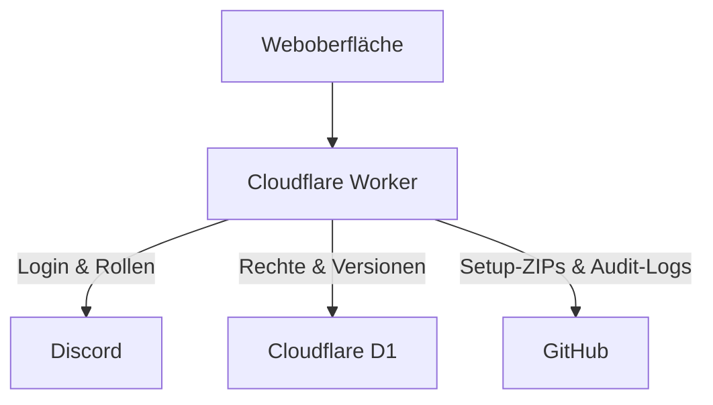

<p align="center">
  <a href="https://le-mans-ultimate-setups.lukastraudt-racing.workers.dev/">
    <picture>
      <source media="(max-width: 600px)" srcset=".github/readme/hero-mobile.svg">
      
    </picture>
  </a>
</p>

<p align="center">
  <a href="https://le-mans-ultimate-setups.lukastraudt-racing.workers.dev/"></a>
  <a href="CHANGELOG.md"></a>
</p>

<p align="center">
  <a href="#funktionen">Funktionen</a> &nbsp; / &nbsp;
  <a href="#zugriff">Zugang</a> &nbsp; / &nbsp;
  <a href="#technik">Technik</a> &nbsp; / &nbsp;
  <a href="#changelog">Änderungen</a>
</p>

<h1 align="center">Weniger suchen. Mehr fahren.</h1>

<p align="center">
  Die Setup-Zentrale von <strong>Three Peaks Racing</strong> für <strong>Le Mans Ultimate</strong>.<br>
  Setups finden, Versionen pflegen und das Team über Discord zusammenbringen.
</p>

<a id="funktionen"></a>

## Alles für den nächsten Stint

<table>
  <tr>
    <td width="50%" valign="top">
      <sub><strong>01 / DATABASE</strong></sub>
      <h3>Dein Fahrzeug. Deine Strecke.</h3>
      <p>Hypercar, LMP2, LMP3 und LMGT3 an einem Ort. Nach Klasse, Fahrzeug und Strecke suchen und die passende Setup-ZIP herunterladen.</p>
    </td>
    <td width="50%" valign="top">
      <sub><strong>02 / UPLOAD</strong></sub>
      <h3>Mehrere ZIPs. Ein Überblick.</h3>
      <p>Mehrere Dateien nacheinander hochladen. Gesamtfortschritt, aktuelle Datei und Einzelstatus bleiben sichtbar; fehlgeschlagene Uploads lassen sich erneut starten.</p>
    </td>
  </tr>
  <tr>
    <td width="50%" valign="top">
      <sub><strong>03 / VERSIONEN</strong></sub>
      <h3>Immer wissen, was du fährst.</h3>
      <p>Eine Version beim Upload vergeben oder später im Stift-Editor anpassen. Die ZIP muss dafür nicht erneut hochgeladen werden.</p>
    </td>
    <td width="50%" valign="top">
      <sub><strong>04 / TEAM</strong></sub>
      <h3>Mit Discord verbunden.</h3>
      <p>Discord-Login, Rollen und individuelle Freigaben steuern den Zugang. Setup Requests, Audit-Meldungen und ein separater Presence Bot ergänzen die Team-Integration.</p>
    </td>
  </tr>
</table>

### Setups von

<table>
  <tr>
    <td align="center" width="33%"></td>
    <td align="center" width="33%"></td>
    <td align="center" width="33%"></td>
  </tr>
</table>

<a id="zugriff"></a>

## Vom Login zum Setup

1. **[Datenbank öffnen](https://le-mans-ultimate-setups.lukastraudt-racing.workers.dev/)** und mit Discord anmelden.
2. **Zugang prüfen.** Du brauchst die passende Discord-Rolle oder eine individuelle Freigabe durch den Owner.
3. **Klasse und Fahrzeug wählen**, nach der Strecke suchen und das Setup als ZIP herunterladen.

| Funktion | Database Access | Upload / Delete Access |
| :--- | :---: | :---: |
| Datenbank ansehen & Setups herunterladen | Ja | Ja |
| Setups hochladen & löschen | — | Ja |
| Setup-Version bearbeiten | — | Ja |

Upload / Delete Access enthält den Datenbankzugriff. Die Berechtigungen werden serverseitig geprüft; individuelle Freigaben verwaltet der Owner.

<a id="technik"></a>

## Unter der Haube

**Cloudflare Workers** für Website und API · **D1** für Rechte und Versionen · **GitHub** für Setup-ZIPs und Historie · **Discord** für Login und Team-Integration.

<details>
<summary><strong>Architektur & Datenfluss</strong></summary>



| Datei | Aufgabe |
| :--- | :--- |
| [`index.html`](index.html) | Oberfläche, Suche, Downloads und Upload-Anzeige |
| [`runtime-worker.js`](runtime-worker.js) | Produktiver Entry Point und Audit-Ereignisse für Freigaben |
| [`access-worker.js`](access-worker.js) | Zugriffsprüfung, individuelle Freigaben und Versions-Endpunkt |
| [`ui-hotfix.js`](ui-hotfix.js) | UI-Erweiterungen und Versions-Editor |
| [`production-worker.js`](production-worker.js) | Produktive Integrationen zwischen UI und Core |
| [`worker.js`](worker.js) | Core API, OAuth, Uploads und GitHub-Zugriff |
| [`setup-version.js`](setup-version.js) | Persistente Versionsdaten in D1 |
| [`audit-log.js`](audit-log.js) | Audit-Dateien und Discord-Meldungen |

Der Worker durchläuft die Schichten in der aufgeführten Reihenfolge von `runtime-worker.js` bis `worker.js`. Die Konfiguration steht in [`wrangler.jsonc`](wrangler.jsonc), das D1-Schema in [`schema.sql`](schema.sql).

R2 und eine Cloudflare Queue sind als Bindings konfiguriert. Der aktuelle ZIP-Upload schreibt direkt nach GitHub; die Bindings sind keine aktive Upload-Pipeline.

</details>

<details>
<summary><strong>Uploads & Setup-Versionen</strong></summary>

ZIP-Dateien wählen, eine Version eingeben und den Upload starten. Die Dateien werden **einzeln nacheinander** verarbeitet. Die Oberfläche zeigt den Gesamtfortschritt, den aktuellen Dateinamen sowie erfolgreiche und fehlgeschlagene Dateien. Fehlgeschlagene Dateien können erneut hochgeladen werden.

Versionsangaben sind beispielsweise `1.0`, `v2`, `2.1.3` oder `2026.10`. Bestehende Setups ohne Versionsangabe bleiben kompatibel und zeigen `—`. Änderungen im Versions-Editor werden in D1 gespeichert.

</details>

<details>
<summary><strong>Deployment & Discord Presence Bot</strong></summary>

Die Cloudflare-Konfiguration verwendet **`runtime-worker.js`** als Entry Point. Die produktive Website wird über die Cloudflare-Build-Anbindung an `main` bereitgestellt.

Der Presence Bot läuft als separater Node.js-Prozess mit Node.js 20 oder neuer. Er verwendet Discord.js, den Status `DND` und die Aktivität `Le Mans Ultimate`.

```bash
cd discord-presence
npm install
npm start
```

Die erforderlichen Umgebungsvariablen sind in [`discord-presence/.env.example`](discord-presence/.env.example) beschrieben. Weitere Hinweise stehen in [`discord-presence/README.txt`](discord-presence/README.txt).

</details>

<details>
<summary><strong>Zugriffsschutz & Konfiguration</strong></summary>

Die Anwendung verwendet OAuth-State-Prüfung, serverseitige Berechtigungen, Same-Origin-Prüfungen, Eingabe- und Größenprüfung sowie vorbereitete D1-Abfragen. Sessions und Antwort-Header werden im Worker behandelt.

Vertrauliche Werte wie `DISCORD_CLIENT_SECRET`, `DISCORD_BOT_TOKEN`, `GITHUB_TOKEN` und `SESSION_SECRET` werden als Secrets hinterlegt. Sie gehören nicht in das Repository.

</details>

<a id="changelog"></a>

## Der Changelog fährt mit

[`CHANGELOG.md`](CHANGELOG.md) wird nach technischen Änderungen auf `main` automatisch ergänzt. ZIP-Uploads und Audit-Dateien werden gesammelt berücksichtigt, spätestens im täglichen Lauf. Die deutschen Texte entstehen aus Commit-Angaben oder festen Beschreibungen der Dateiänderungen.

Die Automation nutzt im öffentlichen Repository kostenlose GitHub-Standard-Runner. Sie benötigt **keine KI-API und keinen zusätzlichen API-Schlüssel**.

[Änderungen lesen](CHANGELOG.md) &nbsp; / &nbsp; [Automation ansehen](https://github.com/lukasracinglmu/Le-Mans-Ultimate-Setups/actions/workflows/changelog.yml) &nbsp; / &nbsp; [Funktionsweise & Textvorlagen](.github/changelog/README.md)

<p align="center">
  
</p>
